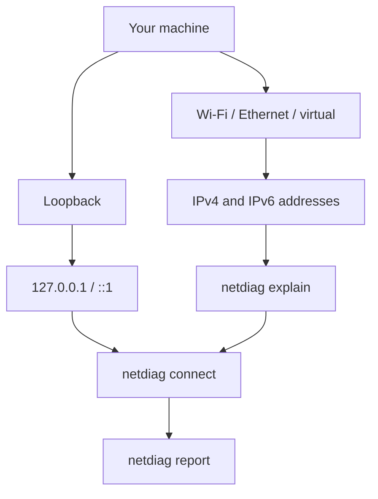
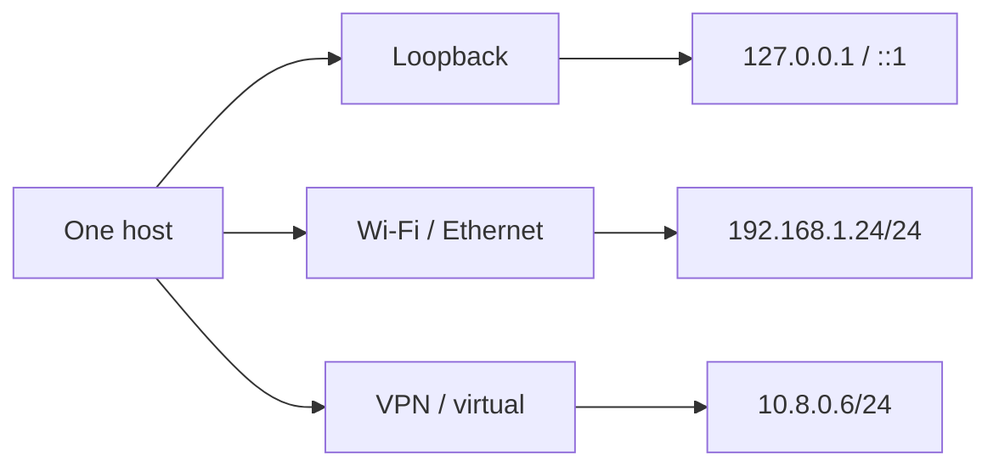
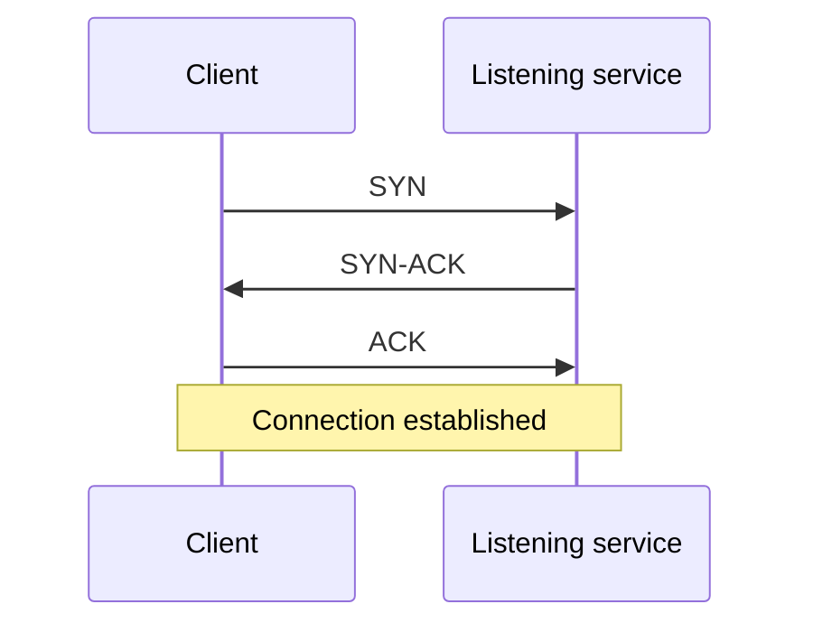
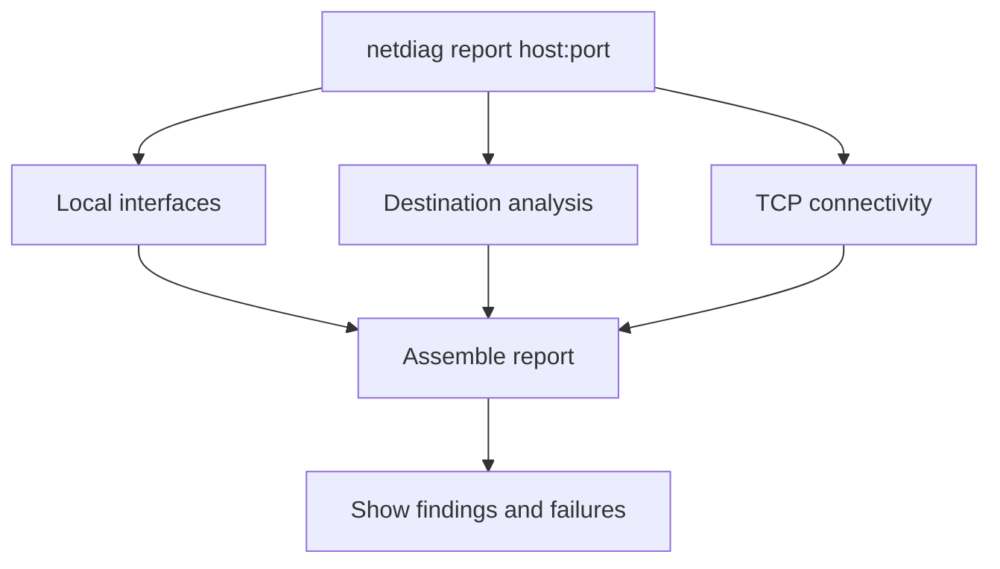

# Chapter 02 — See Your Network: Build a Network Diagnostic Tool

> **Phase:** 1 — Understand the Building Blocks  
> **Level:** L1 — Learning tool  
> **Primary deliverable:** `netdiag`, a CLI for inspecting local interfaces, explaining IP addresses, testing TCP connectivity, and producing a diagnostic report  
> **Prerequisites:** Chapter 00 — Your First Security Lab; Chapter 01 — Decode the Bytes

A service is unreachable. Is it not running, is the route missing, or is something silently dropping traffic? Rayhan wants to investigate the connection. Samia wants to verify that a service intended to be private is not reachable through an unexpected interface.

“Connection failed” is not an explanation. This chapter builds a tool that records what the machine knows about its network, interprets an address, tests one TCP endpoint, and combines those observations into a report.

All automated network exercises use loopback or controlled test dependencies. No public target is required.

## What you will build

By the end, `netdiag` will:

- List local interfaces and their IPv4/IPv6 addresses.
- Classify addresses as loopback, link-local, private, public, or other.
- Explain an IP address and optional CIDR prefix.
- Test one TCP endpoint and distinguish connected, refused, timeout, network-unreachable, and other errors.
- Produce a report that preserves partial findings.

The tool is read-only. It does not change interface configuration, edit routes, scan port ranges, or capture packets.

## Learning outcomes

You will be able to explain interfaces, IP addresses, CIDR prefixes, ports, and TCP connection outcomes; distinguish IPv4 from IPv6 subnet behavior; write deterministic network tests; and avoid treating uncertain network observations as proof.

## Prerequisites

- Complete Chapters 00 and 01.
- Be comfortable with Go basics, terminal use, and the local TCP server/client exercise from Chapter 00.
- Reuse the repository's existing root Go module. If it does not yet exist, initialize it when the first maintained implementation begins. The module path is `github.com/shomi-khan/red-blue-lab`.
- Use only the Go standard library.

## A map before the journey

A host may have several interfaces, and each interface may have multiple addresses. The tool will inspect those addresses, explain a destination, then test one transport endpoint.



This is the tool's learning progression, not a complete diagram of the operating system's network stack.

---

# 02.1 — Local Map: List Network Interfaces and Addresses

Rayhan sees a machine with Wi-Fi, a virtual interface, and loopback. “The machine's IP” is not enough information. Samia needs to know which address belongs to which interface before she can reason about service exposure.

### What you will build

The first `netdiag` command lists each local interface, its flags, and its assigned addresses with CIDR prefixes and classification labels.

### Just-in-time theory

A **network interface** is a logical or physical attachment through which a host communicates. Examples include loopback, Wi-Fi, Ethernet, VPN, and virtual interfaces. An interface can have multiple IPv4 and IPv6 addresses.

Go's standard library exposes this information through the `net` package, including `net.Interfaces()`, interface flags, and interface addresses.

| Flag | Meaning |
|---|---|
| `up` | Interface is administratively up |
| `loopback` | Loopback interface |
| `broadcast` | Supports broadcast |
| `point-to-point` | Point-to-point interface |
| `multicast` | Supports multicast |

An `up` flag is not proof of internet connectivity.

Useful address ranges:

| Class | IPv4 | IPv6 |
|---|---|---|
| Loopback | `127.0.0.0/8` | `::1/128` |
| Link-local | `169.254.0.0/16` | `fe80::/10` |
| Private | RFC 1918 ranges | Unique-local `fc00::/7` |
| Global-unicast | Publicly routable unicast space | Global-unicast space, commonly `2000::/3` |
| Other | Shared, documentation, reserved, unspecified, multicast | Documentation, unspecified, multicast, and other special-use |

Do not label every non-private address as public. For example, `100.64.0.0/10` is IPv4 shared address space, not ordinary public space. Documentation ranges are not public endpoints either.

Use these labels: `loopback`, `link-local`, `private`, `public`, and `other`. Apply specific classifications before considering an address public. If an address is special-use or cannot safely be called public, use `other`.

### Visual explanation



The example addresses are illustrative. A host can have several addresses at the same time.

### Challenge specification

🎯 **Problem**

Build the initial `netdiag` command. It accepts an optional `--all` flag and lists interfaces with their flags and assigned addresses.

**Inputs**

- No positional arguments.
- Optional `--all`: include interfaces with no assigned addresses. By default, omit those interfaces.

**Output**

For each included interface, show its name, flags, address in CIDR notation, family (`IPv4` or `IPv6`), and class.

Illustrative output:

```text
Interface: lo
  Flags: up,loopback
  Address: 127.0.0.1/8
    Family: IPv4
    Class: loopback
  Address: ::1/128
    Family: IPv6
    Class: loopback
```

**Behavioral contract**

- Enumerate interfaces exposed by the operating system.
- Preserve interface names, flags, addresses, and prefix lengths.
- Display all assigned IPv4 and IPv6 addresses.
- Do not assume interface names or that every host has Wi-Fi/Ethernet.
- Do not treat `up` as proof of reachability.
- Do not perform DNS lookups or outbound connections.
- Continue inspecting other interfaces if one interface's address lookup fails, and report the affected interface.

**Constraints and security**

- Standard library only; read-only operation.
- Do not modify interfaces, routes, DNS, or firewall settings.
- Treat interface names and address data as data, not terminal control instructions.

**Edge cases**

- Only loopback exists.
- An interface has no addresses.
- Multiple addresses or both IP families on one interface.
- Virtual/tunnel interfaces.
- Link-local, shared-address, documentation, unspecified, or multicast addresses.
- One interface's address lookup fails.

**Errors**

| Condition | Behavior |
|---|---|
| Interface enumeration fails | stderr diagnostic; non-zero exit |
| One interface lookup fails | Report it and continue where possible |
| No interfaces have addresses | Clear message; no panic |
| Special-use address | Class `other`, not `public` |

**Acceptance criteria**

- Loopback appears when provided by the OS.
- IPv4 and IPv6 are supported.
- Each address includes its prefix, family, and class.
- `--all` includes addressless interfaces; default output omits them.
- No interface name is hardcoded.

**Test expectations**

Unit-test classification with explicit examples: `127.0.0.1`, `::1`, `169.254.10.20`, `fe80::1`, RFC 1918 addresses, IPv6 unique-local, a known global-unicast address, `100.64.0.1`, documentation, unspecified, and multicast addresses. Keep formatting tests separate from OS enumeration. Do not assume a particular interface exists.

**Definition of completion**

Running `netdiag` gives a readable inventory of the local interfaces and addresses with correct labels.

### Verification and debrief

Compare the output manually with `ip addr` or `ifconfig` where available. These are optional manual checks, not test dependencies. The key discovery: a host does not have one universal “IP address”; it has interface configuration, and interface state alone does not prove reachability.

### What's next

02.2 takes one address from this inventory and explains its network prefix.

---

# 02.2 — The Address Decoded: Parse and Explain IP Addresses

Samia sees `192.168.1.24/24` and wants to know which network it belongs to. Rayhan sees `2001:db8::25` and wants an explanation that does not treat IPv6 as IPv4 with extra digits.

### What you will build

Add `netdiag explain <address>` for IPv4 and IPv6 addresses, with optional CIDR analysis.

### Just-in-time theory

IPv4 contains 32 bits and is commonly written as four decimal octets. IPv6 contains 128 bits and is written as hexadecimal groups. An IP address identifies an endpoint at the network layer; it does not identify a person or prove that an application is listening.

CIDR's prefix length counts the leading bits that identify the network. For `192.168.1.24/24`, the first 24 bits are the network portion and the remaining 8 are host bits.

```text
Address:  192.168.1.24
Prefix:   /24
Network:  192.168.1.0/24
Broadcast:192.168.1.255
```

For ordinary IPv4 subnets, conventional usable hosts are `2^(32-prefix)-2`, excluding network and broadcast addresses. This convention has exceptions: `/31` is commonly used for point-to-point links where both addresses can be endpoints, and `/32` identifies one address. Avoid overflow for very large ranges.

IPv6 has no broadcast address. Do not apply the IPv4 host-count formula to IPv6.

An address without a prefix is not enough to infer a network. Do not silently assume `/32` or `/128`.

| Property | IPv4 | IPv6 |
|---|---|---|
| Length | 32 bits | 128 bits |
| Example | `192.168.1.24` | `2001:db8::25` |
| Prefix example | `/24` | `/64` |
| Broadcast | Yes, in IPv4 subnetting | No |

### Challenge specification

🎯 **Problem**

Implement `netdiag explain <address>`.

**Inputs**

Exactly one IP literal, with or without CIDR prefix, e.g. `10.0.1.5/24`, `10.0.1.5`, `2001:db8::25/64`.

**Output**

Show family, normalized address, classification, whether a prefix was supplied, and (when supplied) network address and prefix length. For IPv4, also show broadcast address and conventional usable-host count with explicit `/31` and `/32` handling. For IPv6, show the network prefix only.

Example:

```text
Address:       10.0.1.5
Family:        IPv4
Class:         private
Network:       10.0.1.0/24
Broadcast:     10.0.1.255
Usable hosts:  254 (conventional IPv4 calculation)
```

Without a prefix, explicitly say no network range was specified.

**Behavioral contract**

- Accept IPv4 and IPv6; reject malformed addresses and invalid prefix lengths.
- Do not invent a prefix when none is supplied.
- Normalize the network address from the prefix bits.
- Calculate IPv4 broadcast only for IPv4.
- Do not calculate IPv6 broadcast or IPv4-style host count for IPv6.
- Reuse 02.1 classification semantics.
- No DNS or network calls.

**Constraints and security**

- Standard library only.
- Treat input as untrusted.
- Accept IP literals only, not hostnames.
- Avoid integer overflow for large prefixes.

**Edge cases**

IPv4 and IPv6 with/without prefix; IPv4 `/0`, `/24`, `/30`, `/31`, `/32`; IPv6 `/0`, `/64`, `/128`; host bits set in input; invalid syntax; invalid prefix; IPv4-mapped IPv6.

**Errors**

Missing/extra arguments, malformed address, and invalid prefix must produce concise stderr diagnostics and non-zero exit. A valid address without prefix is successful and must state that no network range was supplied.

**Acceptance criteria**

- `netdiag explain 10.0.1.5/24` reports IPv4, private, network `10.0.1.0/24`, broadcast `10.0.1.255`, and 254 conventional usable hosts.
- An address without prefix does not get an invented network.
- IPv6 is normalized and never shown with a broadcast address.
- Invalid input fails clearly; `/31` and `/32` are not given misleading counts.

**Test expectations**

Use table-driven tests with fixed IPv4/IPv6 inputs, boundary prefixes, host bits set, malformed input, and classification cases. No test depends on the host's interfaces or internet.

**Definition of completion**

The subcommand accurately explains the address and any supplied prefix without inventing missing information.

### Verification and debrief

Check `10.0.1.5/24`, `192.168.1.24/20`, `2001:db8::25/64`, and an address without a prefix. A host address and a network prefix answer different questions; a trustworthy tool keeps them distinct.

### What's next

02.3 moves from interpreting an address to testing one TCP endpoint.

---

# 02.3 — Connect or Not?: Test TCP Connectivity

Rayhan has a destination address and port, but the connection fails. Is the service closed, is a firewall dropping packets, or is the network unreachable? Samia insists that a timeout and a refusal are different observations.

### What you will build

Add `netdiag connect <host:port>` with a configurable timeout and explicit outcome states.

### Just-in-time theory

An endpoint combines an IP address and a transport-layer port. This milestone tests TCP only. TCP establishes a connection with a handshake:



A successful handshake proves that a TCP connection was established, not that the application is healthy.

A refused connection commonly means an explicit rejection, often a TCP reset. A timeout means no conclusive response arrived before the deadline. A firewall drop, path failure, or lost response can all lead to a timeout.

| Result | Evidence | Does not prove |
|---|---|---|
| `connected` | TCP handshake completed | Application health |
| `refused` | Explicit refusal received | Host is generally unavailable |
| `timeout` | Deadline expired without conclusive response | Port is closed |
| `network_unreachable` | OS reports no usable network/route | Application state |
| `error` | Other failure, such as DNS failure | Any specific port state |

The default timeout is 3 seconds. A test must not rely on a non-routable address: routing and firewall behavior differ between machines. Instead, inject a dial operation and supply a controlled timeout error to test classification deterministically.

### Challenge specification

🎯 **Problem**

Implement `netdiag connect <host:port> [--timeout duration]`.

**Inputs**

- Exactly one destination in `host:port` form.
- Optional positive `--timeout`; default `3s`.
- Host may be an IP literal or hostname.
- Port must be 1–65535.

**Output**

Show destination, protocol, state, elapsed time, and evidence.

```text
Destination: 127.0.0.1:8080
Protocol:    TCP
State:       connected
Elapsed:     1.42ms
Evidence:    TCP connection established
```

**Behavioral contract**

States are exactly:

- `connected`: connection established.
- `refused`: explicit connection-refused error.
- `timeout`: configured deadline expired.
- `network_unreachable`: explicit network- or route-unreachable error.
- `error`: all other failures, including DNS resolution failure.

Print elapsed time. Close a successful connection. Never label timeout as refused, or network-unreachable as timeout. If hostname resolution fails, report `error`. Test one endpoint only; no retries or adjacent ports.

**Constraints and security**

- Standard library only; default timeout 3 seconds; timeout must be positive.
- Close every successful connection.
- Do not send application payloads.
- Require authorization for non-loopback destinations.
- Automated integration tests use loopback only.
- The dial operation must be injectable through a small function or interface for deterministic classification tests.

**Edge cases**

Local listener; closed loopback port; injected timeout; injected network-unreachable; unrelated error; DNS failure; invalid host:port; invalid port; zero/negative/malformed timeout; connection close error; deadline boundary.

**Errors**

Invalid arguments, port, or timeout: stderr and non-zero exit. Connected: `connected`, exit zero. Refused, timeout, network-unreachable, or other failure: print the precise state and evidence, exit non-zero.

**Acceptance criteria**

- Local listener yields `connected`.
- Closed loopback port yields `refused`.
- Injected timeout yields `timeout`.
- Injected network-unreachable yields `network_unreachable`.
- Unrelated error remains `error`.
- Successful connection is closed.
- Default and custom positive timeouts are honored.
- Tests do not use public services or arbitrary non-routable addresses.

**Test expectations**

Use loopback integration tests for connected/refused. Use injected errors for timeout, network-unreachable, and other error classification. Test timeout validation and successful connection closure. Never manufacture a timeout by dialing an arbitrary address.

**Definition of completion**

One TCP attempt produces an honest outcome, respects its deadline, closes successful connections, and has deterministic tests for every state.

### Verification

Start a local listener using the Chapter 00 pattern and connect to it. Stop it and retry to observe refusal. Use injected test dependencies to verify timeout and network-unreachable classification.

### Red Team investigation

Rayhan tests only an explicitly authorized lab endpoint and records the vantage point, timeout, elapsed time, and result. A timeout is a reason to investigate, not proof that a port is closed.

### Blue Team defense

Samia compares expected service exposure with observed reachability. A service reachable from loopback may not be reachable through another interface; a failed attempt from one vantage point does not prove all paths are blocked.

### Debrief

A network test is an experiment from one location at one moment. Its result is bounded by that vantage point and the evidence returned. Chapter 03 will reuse these distinctions when scanning a range of ports.

### What's next

02.4 combines the three diagnostic capabilities into one report.

---

# 02.4 — The Diagnostic Report: Assemble All Findings

Samia has three useful observations, but they are scattered across commands. Rayhan wants one report he can attach to an investigation. A report should preserve what was learned even when one diagnostic step fails.

### What you will build

Add `netdiag report <host:port>`, combining interface information, destination analysis, and a TCP connectivity result.

### Just-in-time theory

A report composes independent observations:

1. Inspect local interfaces.
2. Parse and classify the destination.
3. Attempt one TCP connection.
4. Present each result in its own section.

A **section-level failure** means one diagnostic step failed while other independent steps can still run. A **fatal input error** means the request cannot be interpreted safely, such as malformed host:port syntax.

A refused connection should not erase interface information. An interface inspection failure should not prevent destination analysis or a connection attempt.

### Visual explanation



Each section is an independent observation. A failure in one section must not silently erase the others.

### Challenge specification

🎯 **Problem**

Implement `netdiag report <host:port> [--timeout duration]`.

**Inputs**

One destination in `host:port` form and an optional positive timeout, default `3s`. Reuse 02.3 validation.

**Output**

At least three clearly labeled sections:

1. Local interfaces: names, flags, addresses, classifications.
2. Destination: host, port, resolved IP if available, family, classification.
3. TCP connectivity: state, elapsed time, evidence.

Illustrative output:

```text
Network Diagnostic Report
=========================

[1] Local Interfaces
  lo (up,loopback)
    127.0.0.1/8  IPv4  loopback

[2] Destination
  Host:     127.0.0.1
  Port:     8080
  Address:  127.0.0.1
  Family:   IPv4
  Class:    loopback

[3] TCP Connectivity
  State:    connected
  Elapsed:  0.82ms
  Evidence: TCP connection established
```

**Behavioral contract**

- Reuse the behavior and classification rules from 02.1–02.3. Do not create inconsistent duplicate logic.
- Attempt independent sections even if another section fails.
- A connection failure must not prevent interface and destination sections.
- If hostname resolution succeeds, show the exact resolved address used for the attempt.
- If resolution fails, show the error and mark connectivity unavailable; do not invent an address.
- If interface enumeration fails, show the error in section 1 and continue where possible.
- Do not imply every resolved address was tested if only one was attempted.
- Include a summary of completed and failed sections.
- A partial report remains visible and returns non-zero status.

**Constraints and security**

- Standard library only; no interactive prompts.
- Keep timeout default at 3 seconds.
- Read-only; no retries or additional ports.
- Require authorization for non-loopback destinations.
- Preserve all earlier command behavior.
- Distinguish observations from conclusions.

**Edge cases**

All sections succeed; refused/timeout/unreachable; DNS failure; interface enumeration failure; malformed destination; hostname with multiple resolved addresses; one interface address lookup failure; partial report.

**Errors**

Malformed arguments or timeout: stderr and non-zero exit. Interface failure: visible in section 1, continue. Resolution failure: visible in section 2, connectivity unavailable. Connection failure: precise state in section 3, retain other sections. Any non-fatal section failure produces a partial report and non-zero exit. All sections successful: exit zero.

**Acceptance criteria**

- `netdiag report 127.0.0.1:8080` includes all three sections.
- Refused/timeout does not suppress other sections.
- Resolution failure does not fabricate an address.
- Interface failure is visible while independent checks continue.
- The exact address attempted is identified.
- All previous commands retain their behavior.

**Test expectations**

- Loopback listener integration test: all sections and `connected`.
- Closed loopback port integration test: other sections remain with `refused`.
- Inject section results to test interface and resolution failures deterministically.
- Verify partial report output and non-zero exit.
- Run all previous milestone tests as regression tests.

**Definition of completion**

The report combines all three capabilities, preserves partial evidence, and does not make claims stronger than the observations support.

### Verification and debrief

Run the report against a local listener, then stop the listener and run it again. Interface and destination sections should remain stable while the connectivity evidence changes. Inject section failures and verify that independent results remain visible.

A good diagnostic report is an evidence record, not a success message. It states what was inspected, what was attempted, what happened, and what could not be established.

### What's next

Chapter 03 — **Who's Listening?: Build a TCP Port Scanner** — extends the single-endpoint test into a bounded scan. It will reuse the outcome distinctions learned here.

---

## Tool lifecycle and compatibility

| Milestone | Capability added | Behavior to preserve |
|---|---|---|
| 02.1 | Interface listing and address classification | Initial listing |
| 02.2 | Address and CIDR explanation | Listing and classification |
| 02.3 | One TCP endpoint test | All earlier commands |
| 02.4 | Combined diagnostic report | All earlier commands and states |

**Final contract**

- Tool: `netdiag`
- Read-only local inspection plus one explicitly requested TCP test.
- Address classes: `loopback`, `link-local`, `private`, `public`, `other`.
- TCP states: `connected`, `refused`, `timeout`, `network_unreachable`, `error`.
- Default timeout: 3 seconds.
- Successful connections are closed before completion.
- No port ranges, packet capture, or configuration changes.
- Maturity target: L1, suitable for learning, not a hardened production network-management utility.

## Testing strategy

| Area | Required cases | Demonstrates |
|---|---|---|
| Address classification | Loopback, link-local, private, global, special-use | Correct boundaries |
| Interface formatting | Multiple addresses, no addresses, IPv4 + IPv6 | Correct grouping |
| CIDR | IPv4/IPv6, with/without prefix | Correct parsing |
| IPv4 subnet math | /0, /24, /30, /31, /32 | Correct boundary conventions |
| IPv6 prefix | /0, /64, /128 | No broadcast calculation |
| TCP connected/refused | Local listener | Real loopback integration |
| Timeout/unreachable/error | Injected errors | Deterministic state classification |
| Timeout validation | Default, custom, zero, negative | Deadline behavior |
| Connection lifecycle | Successful connection closed | No leaked connection |
| Report composition | Success and individual section failures | Partial evidence preserved |
| Regression | All earlier milestone tests | No behavior lost |

Use table-driven unit tests, injected dependencies, and loopback integration tests. Do not depend on public internet, external DNS, arbitrary non-routable addresses, or the machine's routing table. Run the full test suite after every milestone.

## Red/Blue learning

🔴 **Rayhan — Red Team**

Network diagnostics are the foundation of reconnaissance. Rayhan uses interface and address information to understand network context, then tests one authorized endpoint. He records the vantage point, timeout, and exact result. He does not treat timeout as proof that a port is closed.

🔵 **Samia — Blue Team**

Samia verifies expected service exposure. She checks local addresses and compares the intended access path with observed connectivity. A service reachable through loopback may not be reachable through another interface; one failed vantage point does not prove all paths are blocked.

**Shared lesson:** An address classification is not a reachability test, an interface flag is not proof of internet access, and a timeout is not proof of a closed port. Preserve the evidence and state exactly what it does and does not establish.

## Publication checklist

- [ ] All four milestones follow curriculum order.
- [ ] Each milestone adds one focused capability.
- [ ] No implementation solution is included.
- [ ] Every challenge defines inputs, outputs, behavior, constraints, edge cases, errors, security, acceptance, tests, and completion.
- [ ] Non-private addresses are not automatically labeled public.
- [ ] IPv4 and IPv6 behavior is distinguished.
- [ ] Timeout and network-unreachable remain distinct.
- [ ] Automated network tests use loopback or injected dependencies.
- [ ] Successful connections are closed.
- [ ] Diagrams are embedded and explained.
- [ ] Earlier tests remain regression coverage.
- [ ] Names, commands, states, and limits match the curriculum.
- [ ] No tests are claimed to have passed unless run.
