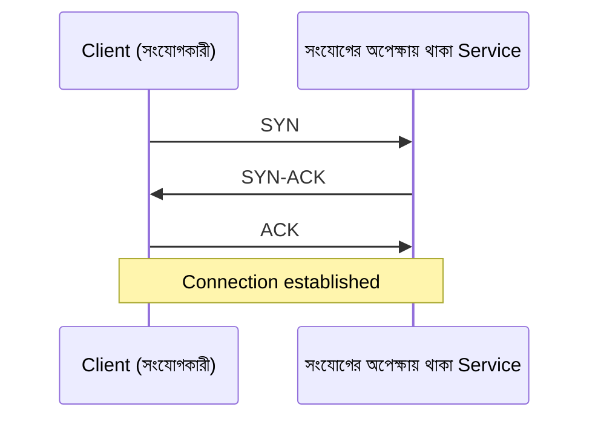
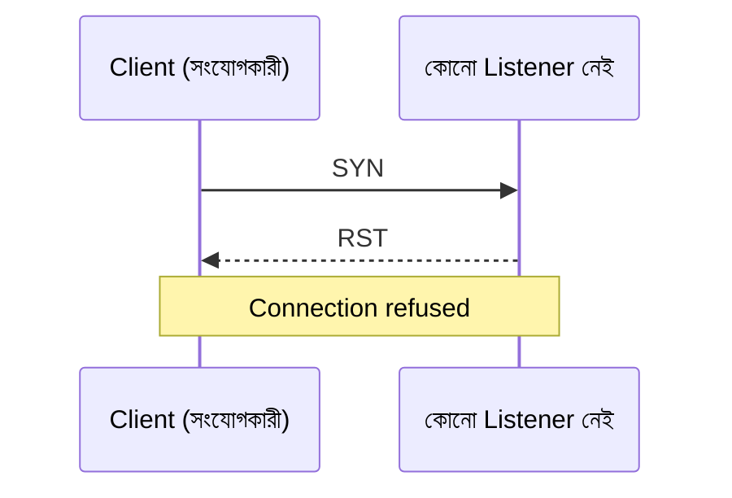
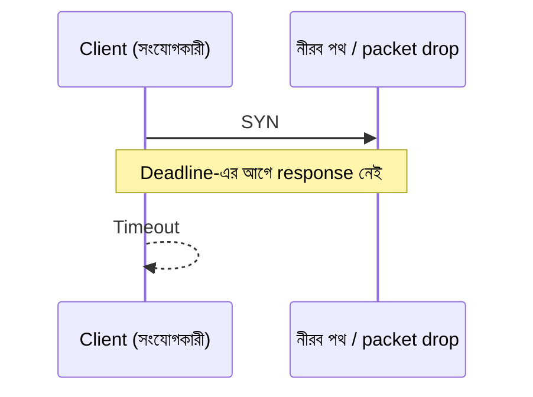
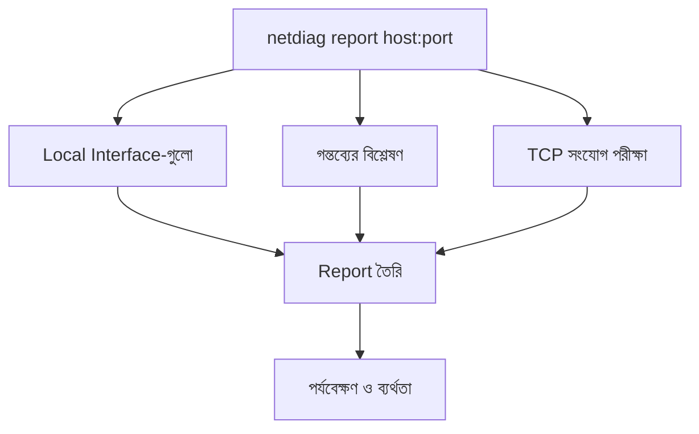

# অধ্যায় ০২: নিজের Network দেখো, একটি Network Diagnostic Tool তৈরি

> **পর্যায়:** ১, ভিত্তি বোঝা  
> **স্তর:** L1, learning tool  
> **প্রধান deliverable:** netdiag, local interface, IP address ও TCP connectivity পরীক্ষা করার CLI tool  
> **পূর্বশর্ত:** [Chapter 00](../00-your-first-security-lab/README.md) এবং [Chapter 01](../01-decode-the-bytes/README.md)-এর byte-level ভিত্তি

Byte inspection-এ পাওয়া একটি readable fragment-এ local service-এর port number আছে, কিন্তু সেটি এখনো কেবল একটি clue। Rayhan ধরে নিতে চায় service-টি বন্ধ। Samia তার terminal-এ connection error দেখিয়ে প্রশ্ন করে, “তুমি কি জানো service বন্ধ, নাকি তোমার machine-ই ঠিকমতো network-এ পৌঁছাতে পারছে না?”

দুজন Chapter 00-এর loopback lab-এ ফিরে আসে। তাদের সামনে কয়েকটি আলাদা সম্ভাবনা: interface down, address ভুল, route অনুপস্থিত, listener বন্ধ, অথবা response নির্ধারিত সময়ের মধ্যে না আসা। একটি failed connection এসবের মধ্যে পার্থক্য করতে পারে না। এই অধ্যায়ে তুমি `netdiag` তৈরি করবে, যাতে প্রতিটি observation আলাদা করে দেখা যায় এবং evidence যতটুকু বলে, conclusion-ও ততটুকুই হয়।

## কী তৈরি করবে

চারটি milestone শেষে tool পারবে:
- Local network interface ও address তালিকাভুক্ত করতে।
- IPv4/IPv6 address এবং CIDR prefix ব্যাখ্যা করতে।
- একটি নির্দিষ্ট TCP endpoint-এ connection পরীক্ষা করতে।
- আগের capability একত্র করে partial failure-সহ report তৈরি করতে।

Tool read-only। এটি interface configuration বদলাবে না, packet capture করবে না, port range scan করবে না।

## শেখার ফল

1. Network interface ও address আলাদা করতে।
2. IPv4/IPv6 এবং CIDR prefix ব্যাখ্যা করতে।
3. Loopback, link-local, private, public ও special-use address আলাদা করতে।
4. TCP success, refusal, timeout ও network error-এর পার্থক্য বুঝতে।
5. Observation এবং conclusion আলাদা রাখতে।
6. Independent section ব্যর্থ হলেও partial report তৈরি করতে।

---

# 02.1: Local Network Interface-এর মানচিত্র তৈরি করো

Samia প্রথমে Rayhan-এর অনুমান থামায়। Destination নিয়ে আলোচনা করার আগে জানতে হবে machine-টি নিজে কোন interface ও address ব্যবহার করছে। তারা local network-এর মানচিত্র তৈরি করবে, তবে interface up দেখেই বাইরের service reachable বলে ধরে নেবে না।
Samia প্রথমে জানতে চায় machine-এ কোন network interface আছে এবং সেগুলোতে কোন address bind করা।

### ধারণা

Network interface হলো host-এর network communication endpoint। যেমন Ethernet, Wi-Fi বা loopback। Interface-এর নাম, flags এবং address আলাদা তথ্য। এখানে **interface flags** বলতে OS-এর দেওয়া interface-state বৈশিষ্ট্য বোঝায়, যেমন `up`, `loopback` বা `broadcast`; এগুলো IP address নয়।

| শ্রেণি | IPv4-এর নিয়ম | IPv6-এর নিয়ম |
|---|---|---|
| loopback | 127.0.0.0/8 | ::1/128 |
| link-local | 169.254.0.0/16 | fe80::/10 |
| private / unique-local | RFC1918-এর 10/8, 172.16/12, 192.168/16 | Unique Local Address (ULA), fc00::/7 |
| public | Global unicast এবং special-use নয় | Global unicast এবং special-use নয় |
| other | উপরের শ্রেণিতে পড়ে না, অথবা special-purpose | উপরের শ্রেণিতে পড়ে না, অথবা special-purpose |

এখানে private শব্দটি IPv4-এর RFC1918 range বোঝায়; IPv6-এ সমতুল্য local-use শ্রেণির নাম **Unique Local Address (ULA)**। ULA prefix হলো fc00::/7। fc00::/8 বর্তমানে সাধারণভাবে ব্যবহৃত নয়, কিন্তু পুরো /7-কেই ULA শ্রেণি হিসেবে চিনবে।

“Private/ULA নয়” মানেই “Public” নয়। Documentation, multicast, unspecified, reserved, benchmarking, transition এবং অন্যান্য special-use range-কে public বলা যাবে না। Public শ্রেণিতে ফেলবে কেবল এমন global-unicast address-কে, যা কোনো special-use range-এর অংশ নয়।

### Challenge-এর শর্ত

**সমস্যা:** netdiag interfaces command তৈরি করো।

**Input:** কোনো argument নয়।

**Output:** প্রতিটি interface-এর name, flags এবং address list। প্রতিটি address-এর সঙ্গে IPv4/IPv6 family, prefix থাকলে সেটি এবং classification দেখাবে।

উদাহরণ:

```text
Interface: lo
  Flags: up, loopback
  Addresses:
    127.0.0.1/8   IPv4  loopback
    ::1/128       IPv6  loopback
```

**আচরণগত contract**
- OS থেকে interface enumeration করবে।
- Interface name ও flags দেখাবে।
- প্রতিটি address আলাদা entry হবে।
- IPv4 ও IPv6 আলাদা করে চিহ্নিত করবে।
- Prefix পাওয়া গেলে দেখাবে; না থাকলে prefix বানাবে না।
- Address classification consistent হবে।
- IPv4 RFC1918-কে private এবং IPv6 fc00::/7-কে unique-local হিসেবে classify করবে।
- IPv4 ও IPv6-এর loopback/link-local range আলাদাভাবে চিনবে।
- IANA special-purpose range-কে public হিসেবে classify করবে না।
- Address না থাকলে স্পষ্ট দেখাবে।
- একটি address parsing ব্যর্থ হলে অন্য interface বাদ যাবে না।
- Output deterministic হবে, যেমন interface name ও address-এর lexical order।

**সীমাবদ্ধতা ও নিরাপত্তা**
- Go standard library only।
- Network configuration পরিবর্তন নয়।
- Public internet connection নয়।
- Test-এ নির্দিষ্ট interface count ধরে নেওয়া যাবে না।

**Edge cases:** একাধিক interface, IPv4-only, IPv6-only, dual-stack, address-বিহীন interface, down interface, unsupported address এবং enumeration failure।

**Acceptance criteria**
- Interface name, flags ও address সঠিক।
- IPv4/IPv6 আলাদা।
- Special-use address ভুল করে public নয়।
- Address না থাকলে স্পষ্ট।
- Output deterministic।
- Failure হলেও অন্য interface-এর তথ্য অক্ষত।

**Tests:** Classification-এর table-driven unit test। IPv4 RFC1918, IPv6 ULA (fc00::/7), দুই family-এর loopback/link-local এবং IANA special-purpose address test করো; special-use address যেন public না হয়। Formatting test-এ synthetic data inject করো। Host-এর বাস্তব interface count-এর ওপর নির্ভর করবে না।

**সম্পন্ন হওয়ার শর্ত:** Local interface inventory এবং প্রতিটি address-এর সংযত, সঠিক classification।

---

# 02.2: IP Address ও CIDR ব্যাখ্যা করো

Interface inventory-তে destination-এর একটি IP address পাওয়া গেছে, পাশে CIDR prefix-ও আছে। Rayhan address-টিকে host-এর পরিচয় হিসেবে পড়ছে; Samia জানতে চায় prefix-টি network-এর কোন অংশ নির্ধারণ করছে। পরের ধাপে address ও subnet-এর অর্থ আলাদা করে ব্যাখ্যা করতে হবে।
Rayhan destination পেয়েছে, কিন্তু address-এর সঙ্গে prefix থাকলে সেটির অর্থ কী? Samia চায় tool যেন host address, network address ও prefix length গুলিয়ে না ফেলে।

### ধারণা

IP address host-কে identify করে। CIDR prefix বলে address-এর কত bit network অংশ নির্দেশ করে। IPv4 address 32 bit; IPv6 128 bit। IPv4-এ network ও broadcast address আছে। IPv6-এ broadcast নেই।

IPv4 subnet convention:
- /0: network 0.0.0.0/0, broadcast 255.255.255.255, conventional usable count 4,294,967,294। হিসাব overflow-safe হতে হবে।
- /31: point-to-point link-এ দুই address-ই usable endpoint।
- /32: একটি নির্দিষ্ট address; usable count 1।

IPv6-এ broadcast address হিসাব করবে না।

### Challenge-এর শর্ত

**সমস্যা:** netdiag explain <ip-or-cidr> তৈরি করো।

**Input:** একটি IPv4/IPv6 address, optional CIDR prefix।

**Output:** Original input, family, address, prefix (দেওয়া থাকলে), network/prefix address, classification এবং প্রযোজ্য subnet summary।

**Behavioral contract**
- IPv4 ও IPv6 parse করবে।
- Prefix না থাকলে network calculation বানাবে না; prefix not supplied দেখাবে।
- Prefix range IPv4-এ 0–32, IPv6-এ 0–128।
- Host bits set থাকলেও network address সঠিকভাবে calculate করবে।
- IPv4 network, broadcast ও conventional usable count দেখাবে।
- /31-এ দুই endpoint usable; /32-এ একটি address।
- IPv6-এ broadcast নেই।
- IPv6 /0, /64, /128 সঠিকভাবে handle করবে; huge count overflow ছাড়া দেখাবে।
- IPv4-mapped IPv6 যেমন ::ffff:192.0.2.1 normalize করে IPv4 192.0.2.1 দেখাবে।
- Mapped prefix /96–/128 IPv4 /0–/32-এ translate হবে। /95 বা তার কম mapped prefix reject হবে।
- Invalid input error; fabricated host count নয়।

**Edge cases:** IPv4/IPv6, prefix ছাড়া address, host bits set, /0, /31, /32, IPv6 /0 ও /128, malformed address, out-of-range prefix, mapped IPv6 ও mapped prefix boundary।

**Acceptance criteria**
- 10.0.1.5/24, 192.168.1.24/20, 2001:db8::25/64 সঠিক ব্যাখ্যা।
- Prefix না থাকলে network detail অনুমান নয়।
- /0, /31, /32 semantics সঠিক।
- IPv6-এ broadcast নেই।
- Mapped IPv6 normalization ও prefix translation সঠিক।
- Invalid input স্পষ্টভাবে reject।

**Tests:** Fixed address ও prefix দিয়ে table-driven test। Host machine বা internet dependency নয়।

**সম্পন্ন হওয়ার শর্ত:** Address ও prefix-এর অর্থ সঠিকভাবে ব্যাখ্যা, অনুপস্থিত তথ্য অনুমান নয়।

---

# 02.3: TCP Connection পরীক্ষা করো

Address-এর গঠন বোঝা গেছে, কিন্তু service এখনো সাড়া দিচ্ছে কি না জানা যায়নি। Rayhan একটি TCP connection attempt করতে চায়। Samia বলে, “সফল handshake, refusal আর নীরব timeout তিনটি আলাদা observation। একটিকে আরেকটির নামে লিখবে না।”
একটি address ও port জানা থাকলেই service reachable প্রমাণ হয় না। TCP attempt-এর ফলাফল কী evidence দেয়, সেটি আলাদা করে বুঝতে হবে।

### TCP Handshake বা সংযোগ স্থাপনের ধাপ



সফল handshake প্রমাণ করে TCP connection তৈরি হয়েছে। Application সুস্থ বা সঠিক response দেবে, তা প্রমাণ হয় না।

### Connection প্রত্যাখ্যান (Refusal)



### Timeout বা নির্ধারিত সময়সীমা



Timeout মানে এই vantage point থেকে deadline-এর মধ্যে conclusive response পাওয়া যায়নি। এটি port closed হওয়ার প্রমাণ নয়।

| বৈশিষ্ট্য | TCP | UDP |
|---|---|---|
| যোগাযোগের ধরন | Connection-oriented byte stream | Connectionless datagram |
| সংযোগ স্থাপন | Three-way handshake | TCP-style handshake নেই |
| সরবরাহ ও ক্রম | Reliable ordered stream semantics | UDP নিজে delivery/order guarantee করে না |
| এই milestone | পরীক্ষা হবে | তুলনার জন্য ধারণা |

| অবস্থা | প্রমাণ | যা প্রমাণ করে না |
|---|---|---|
| connected | TCP handshake সম্পন্ন | Application health |
| refused | Explicit refusal | Host সম্পূর্ণ unavailable |
| timeout | Deadline শেষ, conclusive response নেই | Port closed |
| network_unreachable | OS route/network unavailable জানিয়েছে | Application state |
| error | DNS বা অন্য failure | নির্দিষ্ট port state |

Default timeout 3 seconds। Arbitrary non-routable IP-তে dial করে timeout test করবে না। Routing/firewall behavior machine-ভেদে আলাদা। Injected dial operation দিয়ে controlled timeout test করবে।

### Challenge-এর শর্ত

**সমস্যা:** netdiag connect <host:port> [--timeout duration] তৈরি করো।

**Input**
- ঠিক একটি destination host:port।
- Optional positive timeout; default 3s।
- Host IP literal বা hostname।
- Port 1–65535।

**Output:** Destination, protocol, state, elapsed time ও evidence।

```text
Destination: 127.0.0.1:8080
Protocol:    TCP
State:       connected
Elapsed:     1.42ms
Evidence:    TCP connection established
```

**Behavioral contract**
- State ঠিক পাঁচটি: connected, refused, timeout, network_unreachable, error।
- Explicit connection-refused কেবল refused।
- Deadline expiry timeout।
- Explicit route/network unreachable network_unreachable।
- DNS failure-সহ অন্য error error।
- Elapsed time দেখাবে।
- Successful connection বন্ধ করবে।
- Application payload পাঠাবে না।
- এক endpoint পরীক্ষা; retry বা adjacent port নয়।
- Timeout positive হতে হবে।
- Dial dependency test-এর জন্য injectable হবে।

**Security:** Standard library only। Non-loopback destination-এর জন্য authorization আবশ্যক। Automated integration test loopback-only।

**Edge cases:** Local listener, closed loopback port, injected timeout, injected network-unreachable, unrelated error, DNS failure, invalid host:port, invalid port, zero/negative/malformed timeout, connection close error।

**Error behavior:** Invalid argument/port/timeout stderr ও non-zero। Connected হলে exit 0। অন্য state স্পষ্টভাবে দেখিয়ে non-zero exit।

**Acceptance criteria**
- TCP বনাম UDP পার্থক্য ব্যাখ্যা করতে পারবে।
- SYN/SYN-ACK/ACK, SYN/RST ও SYN/silence case ব্যাখ্যা করতে পারবে।
- Local listener connected, closed port refused।
- Injected error দিয়ে timeout/network-unreachable/error যাচাই।
- Successful connection বন্ধ।
- Default ও custom timeout মানা হয়।

**Tests:** Loopback listener ও closed port integration test; অন্য error injected। Public service বা arbitrary non-routable address নয়।

**সম্পন্ন হওয়ার শর্ত:** একটি TCP attempt evidence-ভিত্তিক state দেয়, timeout মানে এবং connection leak করে না।

---

# 02.4: সব Observation এক Diagnostic Report-এ সাজাও

এখন তাদের কাছে interface, address এবং TCP attempt-এর তথ্য আলাদা আলাদা আছে। Samia চায় একটি report, যেখানে একটি section ব্যর্থ হলেও বাকি evidence হারাবে না। Rayhan-এর কাজ শুধু সব output জোড়া লাগানো নয়; কোন observation সম্পন্ন হয়েছে, কোনটি ব্যর্থ, আর কোন প্রশ্ন এখনো অমীমাংসিত তা স্পষ্ট রাখা।
Samia তিনটি command-এর output একসঙ্গে দেখতে চায়। একটি section ব্যর্থ হলে অন্য independent observation হারানো চলবে না।

### কী তৈরি করবে

netdiag report <host:port> [--timeout duration]। এটি interface, destination analysis ও TCP connectivity এক report-এ রাখবে।

### ধারণা

Report-এর তিনটি independent section:
1. Local interface inventory।
2. Destination parsing/resolution/classification।
3. TCP connectivity।

Section-level failure মানে একটি diagnostic ধাপ ব্যর্থ, কিন্তু অন্যগুলো চালানো সম্ভব। Fatal input error মানে request-ই নিরাপদে বোঝা যাচ্ছে না।



### Challenge-এর শর্ত

**Input:** একটি host:port, optional positive timeout; default 3s।

**Output:** তিনটি section:
- Local Interfaces: name, flags, addresses, classification।
- Destination: host, port, resolved IP (পাওয়া গেলে), family, classification।
- TCP Connectivity: state, elapsed time, evidence।

**Behavioral contract**
- 02.1–02.3-এর logic reuse করবে।
- একটি section ব্যর্থ হলেও independent section চালাবে।
- Hostname একবার resolve করবে এবং নিচের deterministic selection rule প্রয়োগ করবে: সব resolved address deduplicate করে family অনুযায়ী সাজাবে; IPv4 address থাকলে parsed IP byte sequence-এর ascending order-এ প্রথম IPv4 address নেবে। IPv4 না থাকলে একই নিয়মে প্রথম IPv6 address নেবে।
- একই address একাধিকবার এলে একবারই থাকবে। Textual string order নয়, parsed address byte order ব্যবহার করবে।
- নির্বাচিত IP literal-ই dial করবে; report-এ ঠিক সেই address দেখাবে। দ্বিতীয় DNS lookup দিয়ে অন্য address-এ dial নয়।
- Resolution failure হলে error দেখাবে; address বানাবে না।
- Interface enumeration ব্যর্থ হলে section 1-এ দেখিয়ে অন্য section চালাবে।
- একটি address test করে সব resolved address পরীক্ষা হয়েছে এমন দাবি নয়।
- Completed ও failed section-এর summary থাকবে।
- Report সফলভাবে তৈরি/লিখতে পারলে section-level failure সত্ত্বেও exit 0।
- Fatal request/configuration error অথবা report generate/write failure-এ non-zero exit।

**সীমাবদ্ধতা ও নিরাপত্তা**
- Standard library only, interactive prompt নয়।
- Timeout default 3 seconds।
- Read-only; retry বা extra port নয়।
- Non-loopback target-এ authorization লাগবে।
- Observation ও conclusion আলাদা থাকবে।

**Edge cases:** সব section সফল, refused/timeout/unreachable, DNS failure, interface enumeration failure, malformed destination, multiple DNS answers (IPv4 ও IPv6 মিশ্রিত, একই family-তে একাধিক, duplicate answer, IPv4 অনুপস্থিত), একটি interface address lookup failure, partial report।

**Acceptance criteria**
- তিনটি section-ই report-এ থাকে।
- একাধিক DNS answer থাকলে IPv4-কে অগ্রাধিকার এবং একই family-তে parsed address byte order অনুযায়ী প্রথম address নির্বাচন হয়; IPv4 না থাকলে IPv6 থেকে নির্বাচন হয়।
- DNS answer-এর order বদলালেও একই address নির্বাচিত হয়।
- Connection failure অন্য section মুছে দেয় না।
- DNS failure fabricated address তৈরি করে না।
- Exact attempted address report-এ থাকে।
- Partial report section-level failure-এ exit 0।
- Invalid input/configuration এবং report-write failure non-zero।
- আগের command behavior অক্ষত।

**Tests:** Loopback listener ও closed port integration test। Interface/resolution failure injected। Mixed IPv4/IPv6, multiple IPv4, IPv4 অনুপস্থিত, duplicate এবং DNS answer order বদলে deterministic selection যাচাই করো। Partial report এবং exit behavior যাচাই। সব আগের milestone regression test চালাও।

**সম্পন্ন হওয়ার শর্ত:** Report তিন capability একত্র করে, partial evidence ধরে রাখে এবং observation-এর চেয়ে শক্তিশালী দাবি করে না।

---

## Tool-এর ধাপ ও চূড়ান্ত Contract

| ধাপ | সক্ষমতা | আগের আচরণ |
|---|---|---|
| 02.1 | Interface listing ও address classification | Initial inventory |
| 02.2 | IP/CIDR ব্যাখ্যা | Listing/classification |
| 02.3 | একটি TCP endpoint পরীক্ষা | আগের command |
| 02.4 | Combined diagnostic report | সব আগের state ও command |

চূড়ান্ত contract:
- Tool: netdiag
- Read-only local inspection এবং একটি explicitly requested TCP test।
- Address class: loopback, link-local, private, public, other।
- TCP state: connected, refused, timeout, network_unreachable, error।
- Default timeout 3 seconds।
- Successful connection close হবে।
- Port range, packet capture বা configuration change নেই।
- Maturity: L1, learning tool; hardened production network manager নয়।

## Testing কৌশল

| ক্ষেত্র | আবশ্যিক পরীক্ষা | কী যাচাই করে |
|---|---|---|
| Address classification | Loopback, link-local, private, global, special-use | Boundary |
| Interface formatting | Multiple/no address, IPv4 + IPv6 | Grouping |
| CIDR | IPv4/IPv6, prefix সহ/ছাড়া | Parsing |
| IPv4 subnet math | /0, /24, /30, /31, /32 | Boundary convention |
| IPv6 prefix | /0, /64, /128 | Broadcast না থাকা |
| TCP connected/refused | Local listener | Loopback behavior |
| Timeout/unreachable/error | Injected error | Deterministic classification |
| Timeout validation | Default/custom/zero/negative | Deadline |
| Connection lifecycle | Successful connection close | Leak নেই |
| Report composition | Success ও section failure | Partial evidence |
| Regression | সব আগের test | পুরোনো behavior অক্ষত |

Table-driven unit test, injected dependency ও loopback integration test ব্যবহার করো। Public internet, external DNS, arbitrary non-routable address বা machine routing table-এর ওপর test নির্ভর করবে না।

## Red Team ও Blue Team-এর শেখা

🔴 **Rayhan:** Lab-এর local listener-এ একটি TCP connectivity check চালাবে। Source vantage point, destination/port, timeout, elapsed time ও state লিখবে। Listener বন্ধ করে আবার চালিয়ে connected ও refused তুলনা করবে। Public host বা adjacent port পরীক্ষা করবে না।

**যাচাইযোগ্য ফল:** Investigation note-এ দুই observation ও refusal বনাম timeout-এর পার্থক্য থাকবে। Injected test timeout ও network-unreachable যাচাই করবে।

🔵 **Samia:** একই local service-এর expected exposure লিখবে: listener চালু থাকলে loopback-এ connection গ্রহণ করবে, বন্ধ হলে করবে না। Diagnostic result-এর সঙ্গে expected state তুলনা করবে।

**যাচাইযোগ্য ফল:** Matrix-এ expected state, observed state, vantage point ও evidence থাকবে। Listener চালু অবস্থায় connected, বন্ধের পরে refused। Automated check loopback-only।

**যৌথ শিক্ষা:** Address classification reachability test নয়। Interface up থাকা internet access-এর প্রমাণ নয়। Timeout closed port-এর প্রমাণ নয়। Evidence সংরক্ষণ করো এবং observation আসলে কী প্রমাণ করে তা-ই বলো।

## প্রকাশের আগের Checklist

- [ ] চারটি milestone curriculum order মেনে চলে।
- [ ] প্রতিটি milestone একটি focused capability যোগ করে।
- [ ] কোনো implementation solution দেওয়া হয়নি।
- [ ] Challenge-এ input, output, behavior, constraints, edge cases, errors, security, acceptance, tests ও completion আছে।
- [ ] Non-private address-কে স্বয়ংক্রিয়ভাবে public বলা হয় না।
- [ ] IPv4 ও IPv6 semantics আলাদা।
- [ ] Timeout ও network-unreachable আলাদা।
- [ ] TCP বনাম UDP ব্যাখ্যা আছে, scope TCP-only।
- [ ] Success, refusal ও timeout sequence diagram আছে।
- [ ] /31 ও /32 semantics স্পষ্ট।
- [ ] Partial report section failure-এ exit 0; fatal error non-zero।
- [ ] Red/Blue exercise verifiable local evidence তৈরি করে।
- [ ] Automated network test loopback/injected dependency ব্যবহার করে।
- [ ] Successful connection close হয়।
- [ ] Diagram embedded ও ব্যাখ্যাসহ।
- [ ] Regression test আগের behavior ধরে রাখে।
- [ ] Command, state ও limit curriculum-এর সঙ্গে মেলে।
- [ ] চালানো হয়নি এমন test পাস করেছে বলা হয়নি।
