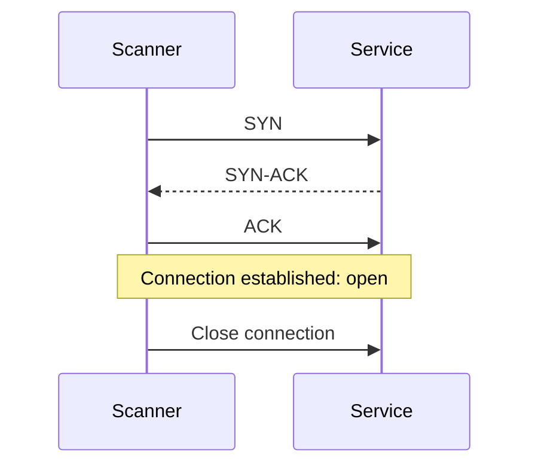
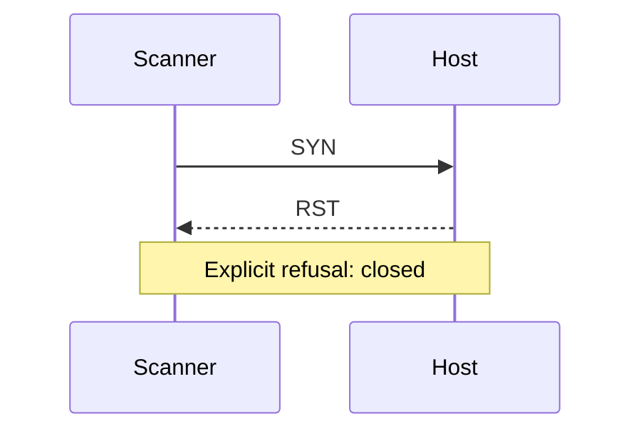
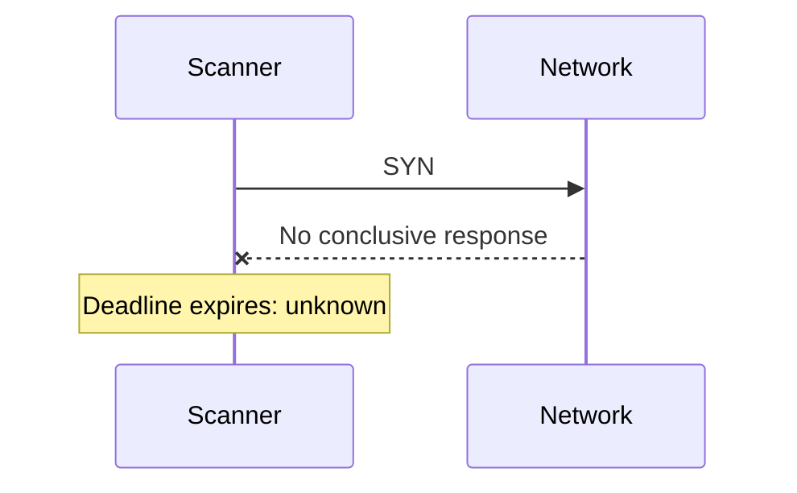
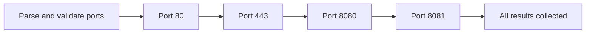
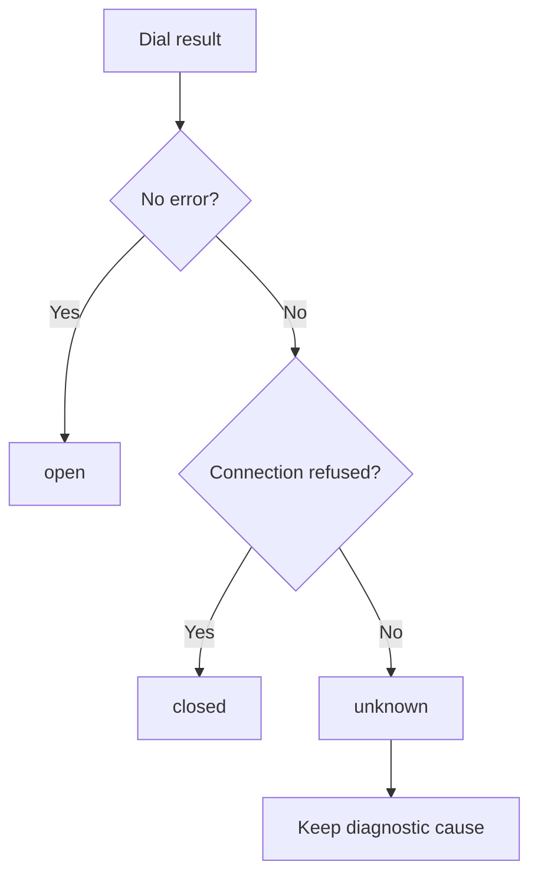
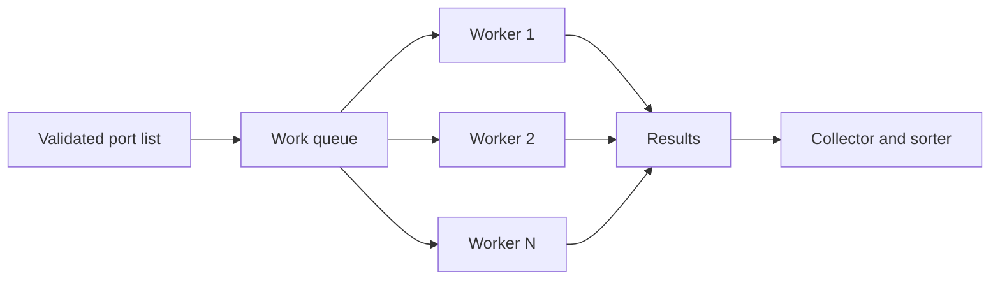
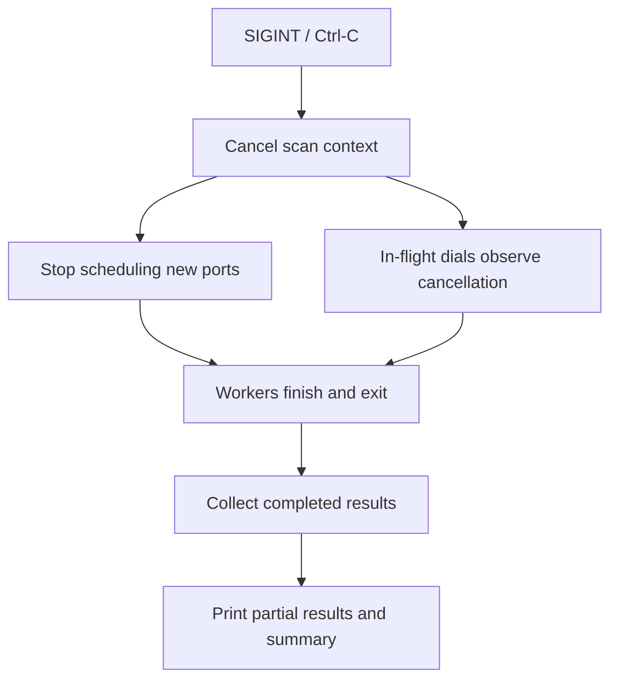

# Chapter 03 — Who's Listening?: Build a TCP Port Scanner

**Phase:** 2 — Discover What's Running on a Network  
**Primary tool:** `portscan`  
**Maturity target:** L2 — Reliable tool  
**Prerequisites:** Chapter 00 (local TCP listener and client), Chapter 02 (IP addressing and TCP connectivity)

---

## The investigation

Rayhan has been given access to a small lab network. He knows the host is reachable, but that tells him very little about what is listening behind it. Samia has a different concern: the team has approved only a handful of services, and she wants evidence that the exposed surface matches that expectation.

They need a tool that asks a narrow question, one TCP port at a time: *can a connection be established here?* The answer must preserve uncertainty. A refused connection is evidence of a closed port; silence is not.

By the end of this chapter, you will build `portscan`, a TCP port scanner that handles ranges, bounded concurrency, timeouts, cancellation, and structured output.

## What you will learn

By completing this chapter, you can:

1. Explain the TCP three-way handshake and the evidence represented by its outcomes.
2. Distinguish `open`, `closed`, and `unknown` without turning every failure into “closed”.
3. Scan a single port, then a list or range of ports.
4. Apply per-connection timeouts and classify errors independently of network activity.
5. Use a bounded worker pool rather than creating unbounded concurrent work.
6. Cancel an in-progress scan and preserve completed results.
7. Produce human-readable and NDJSON output with a stable schema.
8. Test the scanner with local listeners and controlled errors.

## Before you begin

You should already be able to:

- Start and stop a TCP listener bound to `127.0.0.1` using the pattern from Chapter 00.
- Use `netdiag connect` from Chapter 02 and explain the difference between `refused`, `timeout`, and other errors.
- Work with Go functions, errors, goroutines, channels, and command-line arguments.

**Important:** Chapter 02's `netdiag connect` uses the labels `connected`, `refused`, `timeout`, `network_unreachable`, and `error`. This chapter deliberately maps those observations into a scanner-specific three-state contract. Do not change Chapter 02's existing command or output contract.

## The mental model: a port is an observation, not a verdict

A TCP connection begins with a handshake. The diagrams below are conceptual views of the outcomes a scanner can observe. They are not packet captures, and the operating system may perform additional work that is not shown.

### A listening port



A successful dial means the TCP connection was established. It does **not** prove that the application is healthy, correctly configured, or safe.

### A closed port



A connection-refused result is an explicit rejection. It is different from receiving no useful response.

### A filtered or uncertain port



Silence can have several causes: a firewall may drop traffic, a host may be unreachable, or a response may be delayed or lost. The scanner cannot infer “closed” from silence.

### The three states

| State | Evidence | What you may conclude | What you may not conclude |
|---|---|---|---|
| `open` | TCP connection established | A TCP listener accepted a connection from this vantage point at this time | The application is healthy or exploitable |
| `closed` | Explicit connection-refused error | The attempted TCP connection was refused | The host is generally unavailable |
| `unknown` | Timeout or any other inconclusive dial error | The scanner could not establish the port state | The port is closed |

This is the central rule of the chapter: **preserve the strength of the evidence**. Never collapse `unknown` into a boolean “not open”.

---

# 03.1 — One at a Time: Scan a Single Port

Rayhan starts with one approved lab endpoint. Before scanning a thousand ports, he wants to know exactly what one connection attempt can tell him.

### What you will build

The first version of `portscan` accepts a host and one TCP port, makes one connection attempt, and prints one of the three scanner states.

### Just-in-time theory

A TCP connection attempt either establishes a connection or returns an error. The error carries evidence, but not every error identifies the remote port's state.

For this milestone, the classification contract is intentionally small:

- No dial error: `open`.
- Connection refused: `closed`.
- Timeout or any other dial error: `unknown`.

A successful connection must be closed immediately. The scanner is checking whether a connection can be established, not interacting with the application protocol.

### Challenge specification

**Problem**

Implement `portscan <host> --ports <port>` for one TCP port. The required `--ports` syntax is used for a single port, range, and list in every milestone; positional port syntax is not supported.

**Objective**

Make one bounded TCP connection attempt and report its state without overstating what the result proves.

**Inputs**

- Exactly one host argument: an IP literal or hostname.
- Required `--ports` selection containing exactly one decimal port in the range 1–65535.
- No ranges, lists, or concurrency flags in this milestone.
- Default connection timeout: 2 seconds.

**Output**

Print the host, port, protocol, state, and elapsed duration. A successful example:

```text
Host:      127.0.0.1
Port:      8080
Protocol:  TCP
State:     open
Duration:  1.42ms
```

**Behavioral contract**

- Attempt exactly one TCP connection.
- Map a successful connection to `open`.
- Map an explicit connection-refused error to `closed`.
- Map timeout and all other dial errors to `unknown`.
- Close a successful connection before returning.
- Do not send application data, retry, or probe another port.
- A state result is a completed scan observation. Invalid input is a command error, not a port state.

**Constraints and security**

- Use the Go standard library.
- Enforce the 2-second default timeout.
- Do not create unbounded goroutines.
- Automated network tests must bind only to loopback.
- Only scan systems for which you have explicit authorization.

**Edge cases**

- Port 1 and port 65535.
- Port 0, negative values, values above 65535, non-numeric input.
- Empty host and malformed argument count.
- A local listener that accepts a connection.
- A loopback port with no listener.
- A controlled timeout error and an unrelated network error.

**Errors and exit behavior**

- Invalid arguments or invalid port: concise diagnostic to stderr and non-zero exit.
- A completed attempt prints its state. `open` exits zero; `closed` and `unknown` exit non-zero.
- Do not print a misleading `closed` result when the attempt timed out.

**Acceptance criteria**

- A local listener produces `open`.
- A known unused loopback port produces `closed` where the OS returns connection refused.
- A controlled timeout produces `unknown`.
- An unrelated dial error also produces `unknown`.
- A successful connection is closed.
- The default timeout is 2 seconds.

**Verification and tests**

Use a loopback listener for the open case and a closed loopback port for the refusal case. Do not use an arbitrary non-routable address to manufacture a timeout: routing and firewall behavior vary by machine. Instead, test timeout classification with a controlled dial dependency or injected error. The classification logic must be testable without making a network call.

**Red Team — Rayhan**

Scan only the local listener you started. Record the target, vantage point, timeout, and result. Explain why `unknown` is not evidence that the port is closed.

**Blue Team — Samia**

Start only the expected local service, then compare the scanner result with the lab's intended exposure. Confirm that the listener is bound to the intended interface, not merely that the process is running.

**Debrief**

A scanner sees a connection attempt from one place at one time. Its result is evidence about that attempt, not a universal statement about the host.

**What's next:** 03.2 expands the same experiment to multiple ports, still one at a time.

---

# 03.2 — More Ports: Scan a Range Sequentially

Rayhan now has a list of ports to check. He could launch a goroutine for every port, but first he needs a reliable way to parse the requested range and account for every result.

### What you will build

Extend `portscan` to accept a single port, a range, or a comma-separated list, and scan the selected ports sequentially.

### Just-in-time theory

A port number is a 16-bit unsigned value, but not every textual range is valid input. A scanner should validate the entire request before opening connections. Otherwise, it may scan part of a malformed request before discovering the mistake.

The familiar port ranges are:

| Range | Common designation |
|---|---|
| 0–1023 | System / well-known |
| 1024–49151 | User / registered |
| 49152–65535 | Dynamic / private |

These labels describe common allocation conventions, not proof of which application owns a port.

### Visualize sequential work



Only one connection attempt is active at a time. This makes the first multi-port version easy to reason about and gives us a baseline before concurrency is introduced.

### Challenge specification

**Problem**

Add `--ports` to accept a port selection and scan it sequentially.

**Objective**

Parse and validate a complete port selection, then produce exactly one result for each unique requested port.

**Inputs**

- `portscan <host> --ports <selection>`
- A selection may contain:
  - One port: `8080`
  - An inclusive range: `8080-8085`
  - A comma-separated list: `22,80,443`
  - A combination: `22,80,8080-8082`
- Port values must be between 1 and 65535.
- Maximum number of unique selected ports: 65535.

**Output**

Print one line per port using the format `<port> <state>`. Results must be sorted by ascending port number, regardless of the order in which the user supplied them.

```text
22 closed
80 open
443 unknown
8080 open
```

**Behavioral contract**

- Validate the entire selection before starting any network attempt.
- Support a single port, inclusive range, and comma-separated combination.
- Reject empty list elements, malformed numbers, reversed ranges, port 0, and values above 65535.
- Remove duplicates. Each unique port is scanned exactly once.
- Scan sequentially; concurrency is not introduced until 03.4.
- Preserve the state classification from 03.1.
- Print one result for every selected port, including `unknown` results.

**Constraints and security**

- No concurrency in this milestone.
- Never expand a range beyond the maximum of 65535 unique ports.
- Continue to enforce the per-connection timeout.
- Do not begin scanning if any part of the selection is invalid.

**Edge cases**

- A single port; a one-element range such as `80-80`.
- Full range `1-65535`.
- Duplicate entries and overlapping ranges.
- Leading/trailing commas, empty elements, whitespace, non-numeric values.
- Reversed range `100-50`.
- Port 0 and port 65536.
- A range containing both open and closed loopback ports.

**Errors and exit behavior**

Malformed selection: diagnostic to stderr, non-zero exit, and no connection attempts. Once scanning begins, print every result. Exit zero only if every selected port is `open`; if any port is `closed` or `unknown`, exit non-zero. Do not discard successful results because another port failed.

**Acceptance criteria**

- `--ports 8080-8082` produces three sorted results.
- A mixed comma-separated selection is parsed correctly.
- Duplicates produce only one result.
- Invalid selections fail before any dial attempt.
- The scanner remains sequential and preserves all 03.1 behavior.

**Verification and tests**

Start two loopback listeners on known ports and leave one selected port without a listener. Verify the expected `open` and `closed` states and that all selected ports appear. Unit-test parsing separately, including the full range and malformed inputs. Use an injected dial function in parser/runner tests to verify that invalid input triggers zero network attempts.

**Red Team — Rayhan**

Scan a deliberately small, authorized loopback range. Record which ports were open, closed, and unknown. Do not infer the application behind an open port; that is a later chapter's job.

**Blue Team — Samia**

Create an expected-exposure list for the lab service. Compare it with the observed results and flag unexpected open ports for investigation. A port list is an inventory clue, not a service identity.

**Debrief**

A correct range parser is part of the security boundary. Validate first, then act. A scanner that partially executes malformed input is harder to predict and audit.

**What's next:** 03.3 makes timeout configuration explicit and gives error classification its own tests.

---

# 03.3 — Not Every Silence Is a No: Handle Timeouts Properly

Samia sees an `unknown` result and asks whether the scanner waited long enough. Rayhan wants to tune the wait for a slow lab environment without changing what each state means.

### What you will build

Add a configurable `--timeout` and isolate error classification so it can be tested without network activity.

### Just-in-time theory

A timeout is a deadline on an operation. When the deadline expires, the scanner has learned that it did not establish a connection in time. It has not learned that the port is closed.

Operating systems and Go expose errors through wrapped error values. Comparing error strings is brittle: wording can vary, and wrappers may add context. Classification should inspect error types and sentinel errors using error-aware operations.

### Classification flow



Only explicit refusal maps to `closed`. Timeout, network-unreachable, DNS failure, cancellation, and unexpected errors remain `unknown` as scan observations. Command-level cancellation is handled separately in 03.5.

### Challenge specification

**Problem**

Add `--timeout duration` and a separately testable error-classification function.

**Objective**

Make the timeout configurable while preserving the three-state contract for every error category.

**Inputs**

- `portscan <host> --ports <selection> [--timeout duration]`
- Duration must be positive and parseable by Go's duration syntax, such as `500ms`, `2s`, or `1m`.
- Default timeout: 2 seconds.

**Output**

Keep the 03.2 output format. For `unknown`, include a concise diagnostic cause in human-readable mode where practical, without changing the state label.

**Behavioral contract**

- Apply the configured timeout independently to each connection attempt.
- If no timeout is supplied, use 2 seconds.
- A non-positive or malformed timeout is a command error.
- Classification is a pure decision over the returned error; it must not perform network operations.
- No error means `open`.
- An explicit connection-refused error means `closed`.
- Every other error means `unknown`.
- Preserve the underlying cause for diagnostics. Never classify by matching human-readable error strings.

**Constraints and security**

- Do not add retries.
- A slow or unresponsive target must not hold a worker indefinitely.
- Timeout configuration must be validated before scanning begins.
- Keep the classifier independently unit-testable.

**Edge cases**

- Default timeout and custom short/long positive timeouts.
- Zero, negative, malformed, and extremely large duration values.
- Wrapped connection-refused error.
- Timeout/deadline error.
- Network-unreachable error.
- DNS resolution error and unrelated error.
- A successful connection that completes before the deadline.

**Errors and exit behavior**

Invalid timeout: stderr and non-zero exit before any network attempt. A valid scan continues to print all port states. Preserve the 03.2 exit behavior: non-zero if any selected port is not `open`.

**Acceptance criteria**

- Default timeout remains 2 seconds.
- Custom timeout is applied per port.
- Refused maps only to `closed`.
- Timeout and all other errors map to `unknown`.
- Classification tests require no live network.
- All 03.1 and 03.2 tests still pass.

**Verification and tests**

Use controlled errors to test refusal, deadline exceeded, network unreachable, DNS failure, and unexpected failure. Include wrapped errors. Use a loopback listener to verify a real successful connection. Do not rely on a firewall rule, external host, or arbitrary non-routable address to create a timeout.

**Red Team — Rayhan**

Repeat a lab scan with two timeout values. Compare the evidence and explain why a longer timeout may change an observation without changing the meaning of `unknown`.

**Blue Team — Samia**

Review the timeout and error cause in the scan record. A large number of unknown results may indicate filtering, routing problems, or a scan configuration issue. Do not report them as confirmed closed ports.

**Debrief**

Timeout is a limit on waiting, not a remote-port verdict. Separating classification from network calls makes that distinction testable.

**What's next:** 03.4 introduces parallel work with a strict resource ceiling.

---

# 03.4 — Speed Up Safely: Bounded Concurrency

Sequential scanning is easy to reason about, but it can take a long time when every port consumes part of its timeout. Rayhan wants more throughput. Samia wants to know how many simultaneous connections the tool can create.

### What you will build

Replace sequential scanning with a worker pool controlled by `--workers N`.

### Just-in-time theory

Concurrency allows several independent connection attempts to be in progress. Unbounded concurrency is not a free speed boost: it can exhaust file descriptors, memory, ephemeral ports, or the target's connection capacity.

A worker pool puts a ceiling on simultaneous work:



The number of workers bounds the number of concurrent attempts. Results may finish in a different order from the input, so presentation order must be decided separately from execution order.

### Challenge specification

**Problem**

Implement bounded concurrent scanning using a worker pool.

**Objective**

Run multiple connection attempts concurrently while enforcing a configurable upper bound and returning one result per selected port.

**Inputs**

- Existing host, `--ports`, and `--timeout` arguments.
- Optional `--workers N`.
- Default workers: 100.
- Maximum workers: 1000.
- Worker count must be a positive integer.

**Output**

Keep the same human-readable result fields and ascending port order. Execution order must not affect presentation order.

**Behavioral contract**

- Validate worker count before starting the scan.
- Never run more than N dial attempts concurrently.
- Every selected unique port must produce exactly one result unless the scan is later cancelled.
- Collect all completed results and sort by ascending port before presentation.
- Close every successful connection.
- Wait for all workers and result collection to finish before returning.
- Preserve timeout and state classification from 03.3.

**Constraints and security**

- Default worker count is 100; maximum is 1000.
- Reject zero, negative, non-integer, and above-maximum worker counts.
- Do not create one goroutine per port.
- Do not leak goroutines, channels, or connections.
- Do not make a fixed speedup ratio part of correctness. Runtime depends on the OS, machine, network, and test environment.

**Edge cases**

- One port with many configured workers.
- Fewer ports than workers.
- Full 65535-port selection with the default worker limit.
- Invalid worker counts.
- A mix of fast and slow attempts.
- A dial operation that returns immediately.
- A dial operation that reaches its timeout.

**Errors and exit behavior**

Invalid worker count: stderr and non-zero exit before any attempt. For a valid scan, retain the existing result and exit contract. A scan with mixed states must not omit any completed result.

**Acceptance criteria**

- Active dial count never exceeds the configured worker count.
- Every selected port has exactly one result after a completed scan.
- Results are sorted by port, regardless of completion order.
- No worker remains running after the scan returns.
- All previous milestone tests pass.

**Verification and tests**

Use an instrumented test dialer that tracks current and maximum concurrent calls. Assert that the observed maximum never exceeds the configured worker count. Test fewer ports than workers, more ports than workers, errors, and completion ordering. Run `go test -race ./...`. A benchmark may compare sequential and concurrent execution, but measured speedup is informational and must not be a pass/fail threshold.

**Red Team — Rayhan**

Run the same small authorized lab scan with different worker limits. Observe the trade-off between completion time and concurrency. Keep the worker limit within the documented cap.

**Blue Team — Samia**

Treat a burst of connection attempts as observable behavior. Consider how connection rate, source, destination, and time window could help distinguish an approved inventory scan from unexpected probing.

**Debrief**

Concurrency is a resource policy, not just an implementation detail. The worker limit is part of the tool's safety contract.

**What's next:** 03.5 adds cancellation so the operator can stop work without abandoning cleanup.

---

# 03.5 — Cancel Cleanly: Context and Cancellation

Rayhan starts a broad scan and realizes the target range was wrong. Stopping the terminal process abruptly could leave work and connections behind. He needs a deliberate stop that preserves what the scanner has already learned.

### What you will build

Thread a context through the scan and support Ctrl-C cancellation with a clean shutdown and partial results.

### Just-in-time theory

A Go context carries cancellation and deadlines across function boundaries. Cancellation is cooperative: the caller signals that work should stop, and each operation must observe the signal.

A clean cancellation sequence has four parts:

1. Stop scheduling new ports.
2. Let in-flight dial attempts observe cancellation.
3. Collect results that completed before cancellation.
4. Wait for workers to exit and close resources.



Cancellation does not mean every selected port has a result. The output must make that distinction visible.

### Challenge specification

**Problem**

Add context-aware scanning and handle Ctrl-C without leaking work or losing completed observations.

**Objective**

Allow an operator or caller to cancel a scan, return completed results, and shut down all workers and connections cleanly.

**Inputs**

- Existing scan arguments.
- An internal context supplied to the scan operation.
- CLI cancellation through Ctrl-C / SIGINT.

**Output**

On cancellation, print all results completed before cancellation, followed by a clear `scan interrupted` summary. Do not fabricate results for ports that were never attempted or completed.

**Behavioral contract**

- The scan operation must accept a context.
- Stop scheduling new ports after cancellation is observed.
- In-flight connection attempts must be cancellable.
- Preserve only results whose dial attempts completed before cancellation was observed.
- If a dial is terminated by scan-context cancellation (`context.Canceled` or the parent context deadline), count it as interrupted, not as a normal `unknown` port observation. A per-port timeout configured by `--timeout` remains a completed attempt and maps to `unknown`.
- Do not emit a result record for an interrupted attempt or a port that was never started.
- Report selected, completed, interrupted in-flight, and unattempted counts; these must reconcile with the total selection.
- Wait for every worker to exit before returning.
- Close every successfully established connection.
- Distinguish a completed scan from an interrupted scan in the summary.
- Do not panic, deadlock, or send to a closed channel during cancellation.

**Constraints and security**

- Use cooperative cancellation; do not terminate goroutines forcibly.
- Do not leak goroutines or open connections.
- Do not claim that interrupted or unattempted ports are closed or unknown.
- Keep the three-state result contract unchanged for completed attempts only.

**Edge cases**

- Cancellation before the first port is scheduled.
- Cancellation while all workers are blocked in dial attempts.
- Cancellation while some results are already collected.
- Cancellation after the final result but before presentation.
- Repeated cancellation signal.
- A dial operation that returns at the same time cancellation occurs.

**Errors and exit behavior**

A cancelled CLI scan prints partial results and an interruption summary, then exits non-zero. A normally completed scan retains the prior exit behavior. Invalid input remains a command error and must be rejected before scanning begins.

**Acceptance criteria**

- Cancelling a scan stops new work from being scheduled.
- Completed results are preserved and printed.
- A dial interrupted by scan-context cancellation is omitted from normal state results and counted as interrupted; a per-port timeout remains a completed `unknown` result.
- The summary reports selected, completed, interrupted, and unattempted counts, which reconcile exactly.
- In-flight work exits promptly after observing cancellation.
- All workers exit and all successful connections are closed.
- The scan reports interruption distinctly from normal completion.
- No panic or deadlock occurs.

**Verification and tests**

Write a test that cancels the context after a controlled number of results. Use a blocking/instrumented dialer to verify that in-flight operations observe cancellation. Assert that completed results are retained, unscheduled ports have no fabricated result, and all workers have exited before the scan returns. Run the race detector.

**Red Team — Rayhan**

Start a lab scan, cancel it, and retain the partial result set. Explain why a partial scan must never be presented as a complete inventory.

**Blue Team — Samia**

Review the interruption summary and determine which ports remain untested. Make sure an incomplete scan is not used as evidence that the remaining services are absent.

**Debrief**

A reliable scanner must be stoppable. Cleanup and honest partial reporting are part of correctness, not polish.

**What's next:** 03.6 gives scan results a structured format that later tools can consume.

---

# 03.6 — Trust the Results: Structured Output and Tests

The scan is useful to Rayhan, but Samia wants to compare results over time and pass open ports to a later service-identification tool. Human-readable text is useful for people; structured records are easier for programs to consume.

### What you will build

Add JSON output as newline-delimited JSON (NDJSON), preserve human-readable output, and complete the regression test suite.

### Just-in-time theory

JSON represents structured data. NDJSON writes one complete JSON object per line, making it possible to process a stream incrementally without wrapping the entire scan in one large array.

A timestamp and duration are measurements, so they naturally vary between runs. Stable output means a stable schema, field meanings, and deterministic ordering, not byte-for-byte identical output across separate scans.

### Challenge specification

**Problem**

Add `--output human|json` and define a stable scan-result record.

**Objective**

Make scan results readable by a person and consumable by downstream tools without losing state or partial-scan information.

**Inputs**

- Existing scan arguments.
- Optional `--output human`.
- Optional `--output json`.
- Default output: `human`.

**Output contract**

Each completed port result contains:

| Field | Meaning |
|---|---|
| `host` | Host supplied to the scanner |
| `port` | TCP port number |
| `state` | Exactly `open`, `closed`, or `unknown` |
| `duration` | Time spent on this connection attempt |
| `timestamp` | Time the result was recorded |

In JSON mode, emit one JSON object per line:

```json
{"host":"127.0.0.1","port":8080,"state":"open","duration":"1.42ms","timestamp":"2026-10-31T10:00:00Z"}
{"host":"127.0.0.1","port":8081,"state":"closed","duration":"0.31ms","timestamp":"2026-10-31T10:00:00Z"}
```

The values above are illustrative. Actual duration and timestamp depend on the run.

**Behavioral contract**

- Human mode remains the default.
- JSON mode emits valid NDJSON: exactly one JSON object per completed port result.
- Every state is one of `open`, `closed`, or `unknown`.
- Include host, port, state, duration, and timestamp in every result.
- Emit results in ascending port order, including after concurrent execution.
- In JSON mode, stdout contains only JSON records. Diagnostics and interruption summaries go to stderr.
- On cancellation, emit all completed result records and clearly report interruption on stderr. Do not emit placeholder records for uncompleted ports.
- Keep field names and types stable across runs. Timestamps and durations are expected to vary.
- Preserve all previous milestone behavior and tests.

**Constraints and security**

- Use the Go standard library.
- Do not mix human text into JSON stdout.
- Do not serialize internal errors as a replacement for the required state.
- Do not omit `unknown` results.
- Do not claim byte-identical output across runs when timestamps and durations are present.

**Edge cases**

- Empty selection is rejected during validation.
- One result and many results.
- All three states in one scan.
- Cancellation before any result and cancellation after partial results.
- Hostnames and IP literals.
- JSON escaping for unusual but valid host input.
- Invalid output mode.
- A result with a very short duration.

**Errors and exit behavior**

Invalid output mode: stderr and non-zero exit before scanning. In JSON mode, stdout remains parseable as NDJSON even when the scan is interrupted; the interruption explanation belongs on stderr. Preserve the established exit status rules for completed scans and non-zero status for cancellation.

**Acceptance criteria**

- Default mode remains human-readable.
- JSON mode produces one valid JSON object per completed port.
- Every record contains all five required fields.
- Every state is exactly one of the three documented values.
- `jq` can parse each line independently.
- Results remain sorted by port.
- Diagnostics never contaminate JSON stdout.
- Cancellation preserves completed JSON records and reports interruption separately.
- All tests from 03.1–03.5 continue to pass.

**Verification and tests**

Test each state and all required fields. Pipe JSON output through `jq` and verify that every line parses independently. Capture stdout and stderr separately to prove that diagnostics do not contaminate the JSON stream. Test ordering after concurrent completion and partial output after cancellation. Run the complete test suite with `go test ./...` and `go test -race ./...`.

**Red Team — Rayhan**

Export a scan as NDJSON and identify the open-port records that should be passed to Chapter 05. Preserve unknown results in the evidence; do not silently discard them.

**Blue Team — Samia**

Compare the structured scan against an expected exposure inventory. Record unexpected open ports and unknown results separately so that uncertainty does not disappear in a dashboard or report.

**Debrief**

Structured output turns a one-off terminal observation into reusable evidence. Its value depends on a stable schema and honest states.

**What's next:** Chapter 05 — *Identify the Service* — consumes the open-port findings and investigates what is listening.

---

## Final tool contract

| Property | Contract |
|---|---|
| Tool | `portscan` |
| Protocol | TCP only |
| Target | One explicitly supplied host |
| Port selection | Single port, inclusive range, comma-separated list |
| Valid ports | 1–65535 |
| Default timeout | 2 seconds per connection attempt |
| Default workers | 100 |
| Worker limit | 1–1000 |
| States | `open`, `closed`, `unknown` |
| Classification | Success → open; explicit refusal → closed; every other dial error → unknown |
| Cancellation | Stop scheduling, cancel in-flight work, preserve completed results, wait for cleanup |
| Output | Human-readable or NDJSON |
| Resource invariant | No more active dial attempts than configured workers; no leaked workers or connections |
| Maturity | L2 — Reliable tool |

### Compatibility and downstream use

- Chapter 05 (Service Fingerprinter) consumes the open-port findings as candidates for service identification.
- Chapter 18 (Final Engagement) reuses the scanner in the reconnaissance workflow.
- Chapter 02's `netdiag connect` contract remains unchanged. The scanner uses a narrower three-state vocabulary for port-level observations.
- Future changes must preserve the meaning of the three states and the NDJSON fields, or document an intentional compatibility change and update downstream consumers.

## Safety boundary

Port scanning creates network traffic and can trigger monitoring or service protections. All chapter exercises must use loopback listeners or a lab target for which you have explicit authorization. Do not scan public IP ranges, shared infrastructure, or third-party systems without written permission and a clearly defined scope. Keep the worker count and timeout within the defaults unless a controlled lab experiment justifies changing them.

## Chapter completion checklist

- [ ] 03.1 reports one port as `open`, `closed`, or `unknown`.
- [ ] 03.2 validates and scans a port selection sequentially.
- [ ] 03.3 applies a per-connection timeout and tests classification independently.
- [ ] 03.4 enforces bounded concurrency and deterministic result ordering.
- [ ] 03.5 cancels cleanly and preserves completed results.
- [ ] 03.6 emits valid human-readable or NDJSON output.
- [ ] Tests use local listeners and controlled errors, not public services.
- [ ] Regression tests cover every earlier milestone.
- [ ] No goroutine or connection remains after a completed or cancelled scan.
- [ ] Red Team findings and Blue Team exposure review are both complete.
- [ ] All testing claims reflect tests actually run.
