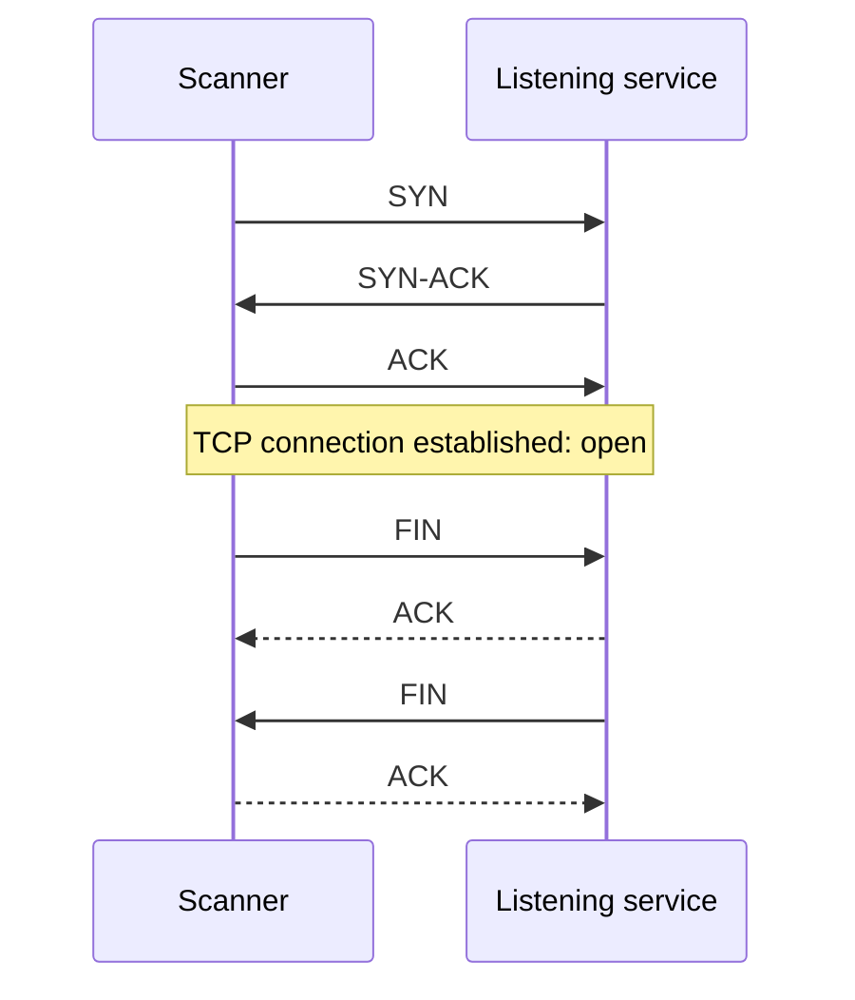
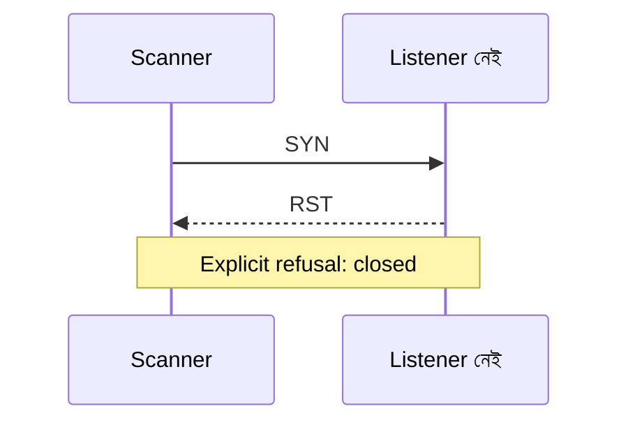
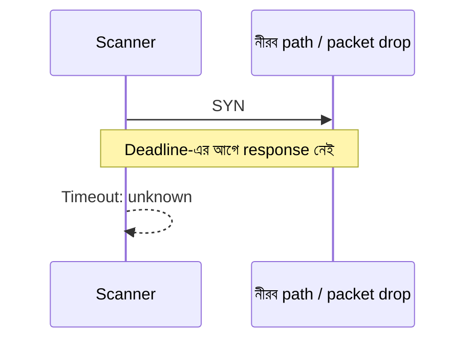
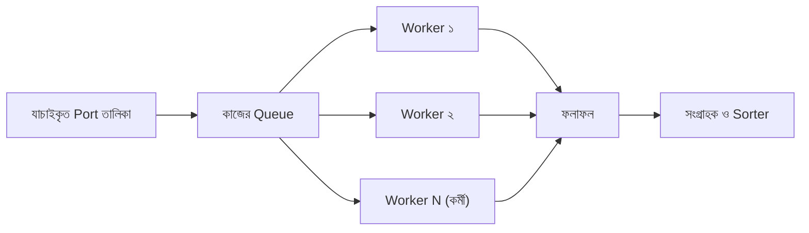
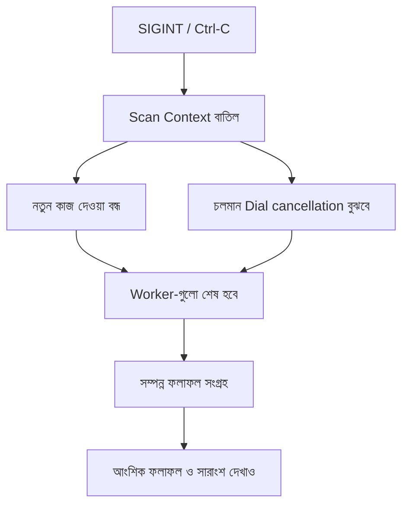

# অধ্যায় ০৩: কে শুনছে? একটি TCP Port Scanner তৈরি

> **পর্যায়:** ২, Network-এ কী চলছে তা আবিষ্কার  
> **স্তর:** L2, reliable tool  
> **প্রধান deliverable:** portscan, একটি host-এর TCP port bounded concurrency-তে পরীক্ষা করার CLI tool  
> **পূর্বশর্ত:** Chapter 00 এবং Chapter 02-এর TCP connectivity ধারণা

Rayhan একটি অনুমোদিত lab host-এর service inventory তৈরি করছে। একটি port-এ connect করা আর অনেকগুলো port পরীক্ষা করা এক কাজ নয়। Samia চায় scanner যেন resource limit মানে, অনিশ্চিত ফলাফলকে “বন্ধ” বলে চালিয়ে না দেয় এবং মাঝপথে থামালেও partial evidence সৎভাবে দেখায়।

এই অধ্যায়ে scanner ধাপে ধাপে তৈরি হবে: একটি port, একাধিক port, timeout classification, bounded concurrency, cancellation এবং structured output।

### কয়েকটি প্রয়োজনীয় Technical term

- **Worker pool:** নির্দিষ্ট সংখ্যক worker-এর দল, যারা queue থেকে কাজ নিয়ে সীমিত সংখ্যায় একসঙ্গে সম্পন্ন করে।
- **Concurrency:** একই সময়ে একাধিক কাজের অগ্রগতি চলা। এটি parallel execution-এর সমার্থক নয়; কাজগুলো একই সময়ে progress করতে পারে, কিন্তু একই মুহূর্তে CPU-তে চলতেই হবে এমন নয়।
- **Context cancellation:** Go-তে context-এর মাধ্যমে চলমান কাজকে থামার সংকেত দেওয়া। এটি জোর করে goroutine বন্ধ করে না; কাজকে cancellation signal মানতে হয়।
- **Evidence:** কোনো state কেন দেওয়া হয়েছে তার পর্যবেক্ষণযোগ্য ভিত্তি। unknown state-ও evidence-এর সীমাবদ্ধতা প্রকাশ করে।

## কী তৈরি করবে

শেষে portscan পারবে:
- একটি নির্দিষ্ট TCP port পরীক্ষা করতে।
- Port selection validate করে sequential scan করতে।
- Timeout ও অন্য error-কে আলাদা evidence হিসেবে classify করতে।
- Configurable worker limit-এ concurrent scan করতে।
- Context cancellation ও Ctrl-C-তে clean shutdown করতে।
- Human-readable অথবা NDJSON output দিতে।

**Scope:** TCP only। এই অধ্যায়ের automated test loopback listener এবং injected error ব্যবহার করবে। অন্য target কেবল নিজের বা লিখিতভাবে অনুমোদিত lab environment-এ।

## শেখার ফল

1. TCP three-way handshake ও connection refusal-এর সঙ্গে port state যুক্ত করতে।
2. Open, closed এবং unknown-এর পার্থক্য করতে।
3. Timeout-কে closed port হিসেবে ভুল না ধরতে।
4. Bounded worker pool দিয়ে concurrency নিয়ন্ত্রণ করতে।
5. Context cancellation-এ worker ও connection পরিষ্কার করতে।
6. Partial scan-কে complete inventory হিসেবে উপস্থাপন না করতে।
7. Stable structured schema তৈরি করতে।

## Port scanner আসলে কী প্রমাণ করে?

TCP connection সফল হলে port-এ connection গ্রহণ করা হয়েছে। Explicit connection refusal সাধারণত RST-এর মাধ্যমে আসে। Timeout হলে নির্ধারিত সময়ের মধ্যে conclusive response পাওয়া যায়নি।

### সফল Connection



### Refusal



### Timeout



এই trace-গুলো সাধারণ outcome বোঝায়। প্রতিটি OS/network-এ packet behavior হুবহু একই হবে, এমন নিশ্চয়তা নয়।

| State | প্রমাণ | অর্থ |
|---|---|---|
| open | TCP connection সফল | Connection গ্রহণ করা হয়েছে |
| closed | Explicit connection refused | Connection প্রত্যাখ্যাত |
| unknown | Timeout বা অন্য ambiguous error | এই attempt থেকে নিশ্চিত সিদ্ধান্ত সম্ভব নয় |

Firewall drop, route failure বা lost response timeout তৈরি করতে পারে। তাই timeout মানেই closed নয়।

---

# 03.1: একটি Port পরীক্ষা করো

### কী তৈরি করবে

একটি host ও একটি TCP port পরীক্ষা করবে।

### Challenge-এর শর্ত

**সমস্যা:** portscan-এর প্রথম increment তৈরি করো।

**CLI:** `portscan <host> --ports <port>`

**Input**
- একটি host।
- একটি port, 1–65535।
- Default connection timeout: 2 seconds।

**Output:** Host, port, state, duration এবং evidence।

**Behavioral contract**
- একটি TCP connection attempt করবে।
- Connection সফল হলে state open।
- Explicit connection-refused হলে closed।
- Timeout বা অন্য dial error হলে unknown।
- Successful connection সঙ্গে সঙ্গে cleanly close করবে।
- Timeout 2 seconds default; পরের milestone-এ configurable হবে।
- DNS ও connection error-কে closed হিসেবে দেখাবে না।

**Edge cases:** Valid open port, closed loopback port, invalid port 0/65536, malformed host, DNS failure, timeout, successful connection close failure।

**Security:** Automated test কেবল 127.0.0.1 বা ::1। Public target নয়।

**Acceptance criteria**
- Local listener open।
- বন্ধ loopback port closed।
- Injected timeout unknown।
- Invalid port scan শুরুর আগেই reject।
- Successful connection close।
- State তিনটির একটিই।

**Tests:** Chapter 00 pattern দিয়ে local TCP listener। Closed port loopback-এ। Timeout ও error classification-এর জন্য controlled dialer। Public service বা arbitrary non-routable address নয়।

**সম্পন্ন হওয়ার শর্ত:** একটি port attempt সঠিক state দেয় এবং resource leak করে না।

---

# 03.2: একাধিক Port ধারাবাহিকভাবে পরীক্ষা করো

একটি port-এর বদলে Rayhan এখন ছোট selection পরীক্ষা করতে চায়। আগে sequential execution রাখলে ফলাফল বোঝা সহজ হবে।

### কী তৈরি করবে

একটি port, inclusive range অথবা comma-separated list গ্রহণ করবে।

**CLI:** `portscan <host> --ports <selection>`

উদাহরণ: `--ports 22`, `--ports 80,443,8080`, `--ports 8000-8010`, `--ports 22,80,8080-8082`।

### আচরণগত Contract
- Port range inclusive।
- Valid port 1–65535।
- Duplicate port বাদ যাবে।
- Scan শুরুর আগে পুরো selection validate হবে।
- Malformed, empty বা invalid range হলে কোনো port scan নয়।
- এই milestone-এ sequential execution; এক সময়ে সর্বোচ্চ একটি dial।
- Result ascending port order-এ দেখাবে।
- প্রতিটি completed port-এর state open/closed/unknown।
- 03.1-এর state classification ও timeout behavior অক্ষত।

**Edge cases:** Single port, single-element range, reversed range, overlapping range, duplicate, empty component, whitespace, port 1/65535, zero, 65536, malformed number।

**Error ও Exit behavior:** Invalid selection হলে stderr-এ error এবং non-zero exit; কোনো port scan হবে না। Valid selection-এর সব port attempt সম্পন্ন হলে ফলাফল `open`, `closed` বা `unknown` যাই হোক exit code `0`। Finding-এর state execution failure নয়।

**Acceptance criteria**
- Single/range/list parsing সঠিক।
- Duplicate বাদ।
- Invalid selection scan শুরু হওয়ার আগে reject।
- Sequential execution।
- Output sorted।
- আগের test অক্ষত।

**Tests:** Table-driven parser test এবং loopback listener দিয়ে ছোট integration scan।

---

# 03.3: Timeout সামলাও, নীরবতাকে 'না' ভেবো না

Timeout হলো অপেক্ষার সীমা, remote port-এর verdict নয়। এখন timeout configurable হবে এবং error classification আলাদা করে test করা হবে।

### কী তৈরি করবে

`--timeout duration`, default 2 seconds।

### Contract
- Positive duration আবশ্যক।
- Timeout প্রতিটি port-এর connection attempt-এ আলাদাভাবে প্রয়োগ হবে।
- Explicit connection refused => closed।
- Timeout/deadline এবং অন্য সব dial error => unknown।
- Error classification string matching দিয়ে নয়; typed/wrapped error semantics দিয়ে।
- Classification logic dial operation থেকে আলাদা test করা যাবে।
- Invalid timeout হলে network attempt-এর আগেই reject।
- সব selected port attempt সম্পন্ন হলে exit code `0`, কোনো port open না হলেও। `open`, `closed` ও `unknown` হলো finding, execution failure নয়।

**Edge cases:** Default, short/long positive timeout, zero/negative/malformed/অত্যন্ত বড় duration, wrapped refusal, deadline error, network unreachable, DNS error, unrelated error, deadline-এর আগে success।

**Security:** Arbitrary non-routable IP বা firewall rule দিয়ে timeout তৈরি করবে না। Controlled error injection ব্যবহার করবে।

**Acceptance criteria**
- Default 2 seconds।
- Custom timeout প্রতি port-এ প্রয়োগ।
- কেবল refusal closed।
- Timeout ও অন্য error unknown।
- Classification test network ছাড়াই।
- আগের milestone test অক্ষত।

**Tests:** Injected refusal, deadline exceeded, network unreachable, DNS failure ও unexpected failure। Wrapped error-ও test করো। Success-এর জন্য loopback listener।

**সম্পন্ন হওয়ার শর্ত:** Timeout ও error classification deterministic এবং evidence-এর সঙ্গে সামঞ্জস্যপূর্ণ।

---

# 03.4: নিরাপদে গতি বাড়াও, Concurrency সীমাবদ্ধ রাখো

Sequential scan সহজ, কিন্তু অনেক port ও timeout থাকলে ধীর। Unbounded goroutine তৈরি করা সমাধান নয়: file descriptor, memory, ephemeral port এবং target-এর capacity শেষ হতে পারে।

### কী তৈরি করবে

Worker pool এবং `--workers N`।



Worker count concurrent dial attempt-এর সর্বোচ্চ সংখ্যা নির্ধারণ করে। Execution order এবং presentation order আলাদা।

### Contract

**Input**
- আগের host, --ports ও --timeout।
- Optional --workers N।
- Default 100; maximum 1000।
- Positive integer আবশ্যক।

**Behavior**
- Scan-এর আগে worker count validate।
- একসঙ্গে N-এর বেশি dial attempt নয়।
- Cancellation না হলে প্রতিটি unique selected port-এর ঠিক একটি result।
- Completed result ascending port order-এ sort।
- Successful connection close।
- সব worker ও result collection শেষ হওয়ার আগে return নয়।
- 03.3-এর timeout/state classification অক্ষত।

**Constraints:** Zero, negative, non-integer ও 1000-এর বেশি reject। প্রতি port-এ আলাদা goroutine তৈরি নয়। Goroutine, channel বা connection leak নয়। Fixed speedup ratio correctness criterion নয়।

**Edge cases:** একটি port ও অনেক worker, port-এর চেয়ে worker বেশি, full 65535-port selection, invalid count, fast/slow attempt mix, immediate dial return, timeout।

**Acceptance criteria**
- Active dial count configured worker-এর বেশি নয়।
- Completed scan-এ প্রতিটি selected port-এর একটি result।
- Result sorted।
- Scan return-এর পর worker অবশিষ্ট নয়।
- আগের test অক্ষত।

**Tests:** Instrumented test dialer দিয়ে current ও maximum concurrent call track করো। Assert করো maximum কখনো worker limit ছাড়ায় না। Fewer/more ports, error ও completion order test করো। `go test -race ./...` চালাও। Benchmark speedup কেবল informational, pass/fail নয়।

**সম্পন্ন হওয়ার শর্ত:** Concurrency সীমাবদ্ধ, ফল deterministic এবং cleanup সম্পূর্ণ।

---

# 03.5: পরিষ্কারভাবে Scan থামাও, Context ও Cancellation

Rayhan ভুল target selection দিয়ে scan শুরু করেছে। Terminal process জোর করে বন্ধ করলে cleanup অসম্পূর্ণ হতে পারে। Scanner-কে থামতে হবে, কিন্তু ইতিমধ্যে পাওয়া evidence রাখতে হবে।

### কী তৈরি করবে

Context-aware scan এবং Ctrl-C/SIGINT cancellation।

### Cancellation-এর ধাপ

1. নতুন port schedule বন্ধ।
2. In-flight dial cancellation observe করবে।
3. Cancellation-এর আগে complete হওয়া result সংগ্রহ।
4. Worker exit ও resource close নিশ্চিত করা।



Cancellation মানে সব selected port-এর result পাওয়া যায়নি।

### Contract

**Input:** আগের scan arguments, internal context এবং CLI-তে Ctrl-C/SIGINT।

**Output:** Cancellation-এর আগে completed result এবং শেষে scan interrupted summary। Never-attempted বা incomplete port-এর fabricated result নয়।

**Behavior**
- Scan operation context গ্রহণ করবে।
- Cancellation observe হওয়ার পর নতুন port schedule নয়।
- In-flight dial cancellable।
- কেবল cancellation observe হওয়ার আগে completed attempt-এর result থাকবে।
- Parent context cancellation/deadline-এ dial থামলে সেটি interrupted, normal unknown observation নয়।
- Per-port --timeout শেষ হলে সেটি completed attempt এবং unknown result।
- Interrupted attempt-এর result record নয়।
- Selected, completed, interrupted in-flight এবং unattempted count দেখাবে; যোগফল total selection-এর সমান।
- সব worker exit না করা পর্যন্ত return নয়।
- Successful connection close।
- Normal completion ও interruption আলাদা।
- Panic, deadlock বা closed channel-এ send নয়।

**Constraints:** Cooperative cancellation; goroutine জোর করে terminate নয়। Worker/connection leak নয়। Interrupted বা unattempted port-কে closed/unknown বলা যাবে না।

**Edge cases:** প্রথম port schedule-এর আগে cancel, সব worker dial-এ blocked, কিছু result collect হওয়ার পরে cancel, final result-এর পর presentation-এর আগে cancel, repeated signal, dial completion ও cancellation একই সময়ে।

**Exit behavior:** স্বাভাবিকভাবে সব selected port attempt সম্পন্ন হলে exit code `0`, finding যাই হোক। Cancelled scan partial result ও summary দেখিয়ে non-zero exit। Invalid input/configuration-এ scan শুরুর আগেই non-zero exit।

**Acceptance criteria**
- Cancellation নতুন কাজ থামায়।
- Completed result অক্ষত।
- Context cancellation-এ interrupted attempt state result নয়; per-port timeout unknown।
- Summary count reconcile করে।
- In-flight work promptly exit।
- Worker ও connection cleanup।
- Panic/deadlock নেই।

**Tests:** নির্দিষ্ট result-এর পরে context cancel করো। Blocking/instrumented dialer দিয়ে cancellation observe যাচাই। Completed result, interrupted ও unattempted count এবং worker exit assert করো। Race detector চালাও।

**সম্পন্ন হওয়ার শর্ত:** Scanner থামে, cleanup করে এবং অসম্পূর্ণ scan-কে সম্পূর্ণ বলে না।

---

# 03.6: ফলাফলের ওপর আস্থা রাখো, Structured Output ও Test

মানুষের জন্য readable output ভালো, কিন্তু পরের tool-এ scan result পাঠাতে structured data দরকার। Timestamp ও duration প্রতিবার বদলাবে। Stable output বলতে schema, field meaning এবং ordering স্থিতিশীল হওয়া বোঝায়, byte-for-byte identical output নয়।

### কী তৈরি করবে

`--output human|json`; JSON mode-এ newline-delimited JSON (NDJSON)। Default human।

### Record-এর Schema

| Field | Type | অর্থ |
|---|---|---|
| host | string | Scanner-এ দেওয়া host |
| port | integer | TCP port |
| state | string enum | `open`, `closed` অথবা `unknown` |
| duration | string | Go duration format-এ connection attempt-এর সময়, যেমন `1.42ms` |
| timestamp | string | RFC3339 timestamp, result record করার সময় |


উদাহরণ:

```json
{"host":"127.0.0.1","port":8080,"state":"open","duration":"1.42ms","timestamp":"2026-10-31T10:00:00Z"}
{"host":"127.0.0.1","port":8081,"state":"closed","duration":"0.31ms","timestamp":"2026-10-31T10:00:00Z"}
```

### Contract

- Human mode default।
- JSON mode-এ প্রতি completed port-এর জন্য এক JSON object per line।
- State ঠিক open/closed/unknown।
- প্রতিটি record-এ পাঁচটি field থাকবে।
- Concurrent execution হলেও result ascending port order-এ।
- JSON stdout-এ শুধু JSON record। Diagnostic ও interruption summary stderr-এ।
- Cancellation-এ completed record emit হবে; incomplete port-এর placeholder নয়।
- Field name/type stable; timestamp/duration naturally vary।
- আগের সব milestone behavior অক্ষত।

**Constraints:** Standard library only। JSON stdout-এ human text নয়। Internal error-কে state হিসেবে serialize নয়। Unknown result বাদ নয়। Timestamp/duration থাকা অবস্থায় byte-identical output দাবি নয়।

**Edge cases:** Empty selection, one/many result, তিন state-ই, cancellation before/after partial result, hostname/IP, unusual host string-এর JSON escaping, invalid output mode, খুব short duration।

**Error ও Exit behavior:** Invalid mode stderr-এ error ও non-zero exit, scan শুরুর আগে। Completed scan-এর সব result emit হলে exit code `0`, finding state যাই হোক। Interrupted JSON stream-এ completed record থাকবে, explanation stderr-এ এবং exit code non-zero।

**Acceptance criteria**
- Default human।
- JSON mode প্রতি completed port-এ valid JSON line।
- পাঁচ field সব record-এ।
- State তিনটির একটি।
- প্রতিটি line jq দিয়ে parse হয়।
- Result sorted।
- Diagnostic stdout contaminate করে না।
- Cancellation completed record রাখে এবং interruption আলাদা দেখায়।
- 03.1–03.5 regression test পাস।

**Tests:** প্রতিটি state ও field test। jq দিয়ে প্রতিটি line parse। stdout/stderr আলাদা capture। Concurrent ordering ও cancellation partial output test। `go test ./...` এবং `go test -race ./...`।

---

## চূড়ান্ত Tool contract

| বৈশিষ্ট্য | Contract |
|---|---|
| Tool | portscan |
| Protocol | TCP only |
| Target | একটি explicitly supplied host |
| Port selection | Single port, inclusive range, comma-separated list |
| Valid ports | 1–65535 |
| Default timeout | প্রতি attempt-এ 2 seconds |
| Default workers | 100 |
| Worker limit | 1–1000 |
| States | open, closed, unknown |
| Classification | Success=open; explicit refusal=closed; অন্য dial error=unknown |
| Cancellation | নতুন কাজ বন্ধ, in-flight cancel, completed result রাখা, cleanup |
| Output | Human-readable অথবা NDJSON |
| Exit code | সব selected port attempt সম্পন্ন হলে 0, finding state যাই হোক; invalid input বা cancellation-এ non-zero |
| Resource invariant | Active dial configured worker-এর বেশি নয়; worker/connection leak নয় |
| Maturity | L2, Reliable tool |

### Compatibility ও downstream use

- Chapter 05 Service Fingerprinter open-port finding-কে service identification candidate হিসেবে ব্যবহার করবে।
- Chapter 18 Final Engagement reconnaissance workflow-এ scanner reuse করবে।
- Chapter 02-এর netdiag connect contract অপরিবর্তিত। Port scanner-এর port-level vocabulary আলাদা ও সংকীর্ণ।
- Future change-এ তিন state ও NDJSON field-এর অর্থ অক্ষত রাখতে হবে; বদলালে compatibility change নথিভুক্ত করে downstream consumer update করতে হবে।

## নিরাপত্তার সীমা

Port scanning network traffic তৈরি করে এবং monitoring বা service protection trigger করতে পারে। সব exercise loopback listener অথবা লিখিত অনুমতিসহ lab target-এ সীমাবদ্ধ। অনুমতি ও scope ছাড়া public IP range, shared infrastructure বা third-party system scan করবে না। Controlled lab experiment ছাড়া worker ও timeout default-এর বাইরে নেবে না।

## Red/Blue learning

🔴 **Rayhan:** Authorized local lab scan থেকে NDJSON export করে open-port record চিহ্নিত করবে, যেগুলো Chapter 05-এ পাঠানো যায়। Unknown result evidence হিসেবে রাখবে; নীরবে বাদ নয়।

🔵 **Samia:** Structured scan-কে expected exposure inventory-এর সঙ্গে তুলনা করবে। Unexpected open port এবং unknown result আলাদা করে নথিভুক্ত করবে, যাতে dashboard uncertainty মুছে না ফেলে।

## অধ্যায় সম্পন্ন করার Checklist

- [ ] 03.1 একটি port-কে open/closed/unknown হিসেবে report করে।
- [ ] 03.2 selection validate করে sequential scan করে।
- [ ] 03.3 per-connection timeout ও error classification।
- [ ] 03.4 bounded concurrency ও deterministic ordering।
- [ ] 03.5 clean cancellation ও completed result সংরক্ষণ।
- [ ] 03.6 human অথবা valid NDJSON output।
- [ ] Test local listener ও controlled error ব্যবহার করে, public service নয়।
- [ ] প্রতিটি milestone-এর regression test আছে।
- [ ] Completed/cancelled scan-এর পর goroutine বা connection অবশিষ্ট নেই।
- [ ] Red Team finding ও Blue Team exposure review সম্পন্ন।
- [ ] Test চালানো না হলে পাস করেছে বলা হয়নি।
