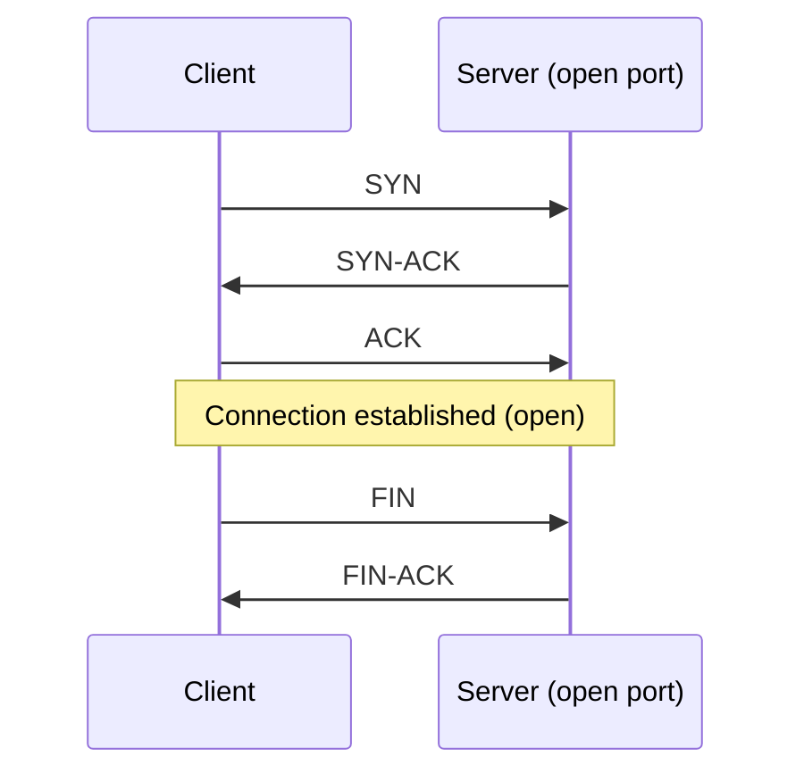
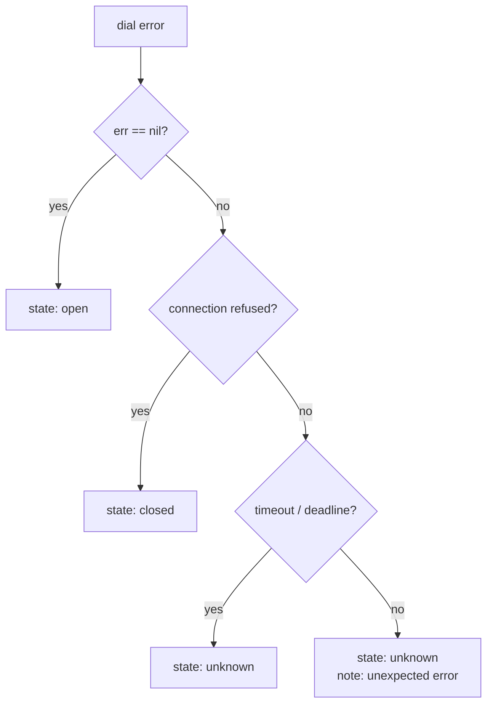

# red-blue-lab Content Guidelines

This document defines the rules that every chapter author — human or AI-assisted — must follow. It is a companion to [`CURRICULUM.md`](CURRICULUM.md), which contains the blueprint for each chapter's learning outcomes, prerequisites, milestones, and tool lifecycle.

Read both documents before writing or modifying a chapter.

---

## The Learning Cycle

Every chapter and subchapter follows this cycle, adapted to the size and nature of the milestone:

```
Story / Problem → Visualize → Learn → Challenge → Verify → Debrief → Reuse
```

| Stage | Purpose | Common Forms |
|---|---|---|
| **Story / Problem** | Motivate the learning with a concrete situation | Rayhan or Samia encounters a real problem; an unexpected result; a security question |
| **Visualize** | Make the concept observable before explaining it | Mermaid diagram, packet figure, byte layout, annotated example |
| **Learn** | Introduce only the theory needed for this milestone | Prose, tables, comparisons, worked examples |
| **Challenge** | Ask the learner to implement the next tool increment | Behavioral contract, constraints, acceptance criteria — no implementation code |
| **Verify** | Confirm the milestone is complete | Test specifications, experiments, comparison with known results |
| **Debrief** | Connect the milestone to the bigger picture | What did this reveal? What was wrong? What is safer now? |
| **Reuse** | Link the capability to the next milestone or chapter | Explicit forward references |

Not every stage requires the same length. A short story paragraph and two sentences of debrief may be all that is needed. Never invent artificial length.

---

## Chapter Structure

Use the following sections as defaults. Omit sections that genuinely do not apply. Do not create empty sections or sections with placeholder text.

### Subchapter sections (typical order)

1. **Subchapter title** (outcome-oriented: what capability is gained)
2. **Story hook** — brief setup from Rayhan or Samia's perspective (1–4 sentences)
3. **What you will build** — one sentence stating the tool increment
4. **Prerequisites** — what the learner must have completed before this subchapter
5. **Just-in-time theory** — the minimum concepts needed for this milestone
6. **Visual explanation** — embedded Mermaid diagram, table, or figure
7. **Challenge specification** — the formal contract (see Section 3 below)
8. **Acceptance criteria** — how the learner knows the milestone is complete
9. **Verification** — test specifications and experiments
10. **Red Team investigation** (when applicable)
11. **Blue Team defense or detection** (when applicable)
12. **Debrief** — what this milestone revealed; lessons
13. **What's next** — explicit link to the next subchapter or chapter

Longer chapters may group multiple subchapters under a chapter preamble that includes the overall story, prerequisites, and expected outcome.

---

## Theory-Writing Rules

### Write only what is needed now

Introduce only the theory required for the current milestone. Do not front-load theory for future milestones. The learner will learn what they need when they need it.

### Be accurate, not simplistic

Prefer technically accurate descriptions. Explain where a simplification is made. Distinguish conceptual models from actual protocol behavior. Do not say "HTTP sends a message" when the accurate description is "the client sends an HTTP request over a TCP connection."

### Prefer examples over abstraction

Before explaining an abstract concept, show a concrete example. After the example, explain the pattern.

✅ Good:
> Here is an HTTP GET request as raw text:
> ```
> GET /index.html HTTP/1.1\r\n
> Host: localhost\r\n
> \r\n
> ```
> The first line is the request line. The second is a header. The blank line (just `\r\n`) terminates the header section.

❌ Avoid:
> HTTP requests consist of a request line followed by headers followed by a blank line followed by an optional body.

### Explain failure modes

Always explain what goes wrong and why, not just the happy path. Security is largely about understanding failures.

### Use unfamiliar terms before introducing them

Never use a term as if it were already known unless it was taught in a previous chapter or earlier in the current subchapter.

---

## Challenge Specification

Every meaningful implementation challenge must include all of the following.

### Required elements

**Problem statement**
One or two sentences describing what the learner needs to build or extend.

**Objective**
The concrete capability that must be present when the milestone is complete.

**Inputs**
What the tool or function receives: arguments, files, environment, network connections. Be specific about types and expected formats.

**Outputs**
What the tool must produce: stdout format, exit codes, file output, error output on stderr. Include examples.

**Behavioral contract**
A precise description of how the tool must behave for all input categories. This is not implementation guidance — it specifies the observable behavior.

Example:
> - If the file does not exist, print an error to stderr and exit with code 1.
> - If `--offset` is given but exceeds the file length, print a clear error and exit with code 1.
> - `--length 0` is valid and produces no output lines.

**Constraints**
Restrictions the learner must respect. May include:
- Performance (timeout must be ≤ N seconds)
- Safety (listen on loopback only)
- API restrictions (must not use a specific third-party library)
- Resource limits (cap at N MiB)
- Behavioral invariants (must not leave connections open)

**Edge cases**
Explicitly enumerate non-obvious inputs that the implementation must handle correctly. Examples: empty file, exactly 16 bytes, invalid UTF-8, port 0, timeout exactly at the boundary.

**Error behavior**
For each error condition: what message to display, which stream (stdout or stderr), what exit code to use.

**Security considerations**
Any security properties that must hold. Examples: credentials must not appear in log output, input validation must prevent path traversal, the tool must use `crypto/rand` not `math/rand`.

**Acceptance criteria**
A list of verifiable conditions. Prefer testable criteria over subjective ones.

Example:
> - `go test ./...` passes with no failures.
> - Running the tool against a known test file produces byte-for-byte matching output.
> - `byteinspect --offset 4 --length 8 testfile.bin` displays exactly 8 bytes starting at index 4.

**Test expectations**
Describe (do not implement) the tests that must pass. The learner writes the tests; this section tells them what to cover.

**Definition of completion**
The single most important criterion. What is the clearest signal that this milestone is done?

### What to omit from challenge specifications

- Implementation approach or code structure
- Which packages to use (unless the package choice is itself the lesson)
- Step-by-step implementation instructions
- Starter code that solves a substantial portion of the challenge

---

## Formal Tool Contracts

Use formal contracts for tools where precise behavior matters. Place the contract before or as part of the challenge specification.

### Contract elements

| Element | Description |
|---|---|
| **Accepted inputs** | Types, formats, ranges, encoding |
| **Output structure** | Fields, types, format (human/JSON/NDJSON) |
| **Valid states** | Enumeration of possible output states (e.g., `open`, `closed`, `unknown`) |
| **Error classification** | Which errors map to which output values or exit codes |
| **Timeout behavior** | How the tool behaves when a deadline expires |
| **Cancellation behavior** | How the tool responds to context cancellation or OS signal |
| **Resource limits** | Maximum connections, body size, goroutines, memory |
| **Security invariants** | Properties that must hold regardless of input |
| **Backward compatibility** | Which behaviors later milestones must preserve |

### State classification rule

Do not collapse distinct evidential states into fewer categories than the evidence supports.

✅ Correct:
> A port produces one of three states:
> - `open` — connection established and cleanly closed
> - `closed` — connection refused (RST received)
> - `unknown` — timeout, network unreachable, or other ambiguous error

❌ Incorrect:
> A port is either `open` (true) or not (`false`).

The learner must not lose information that distinguishes a firewall drop from a closed port. Later milestones may depend on the distinction.

---

## Cumulative Tool Evolution

Every chapter that extends an existing tool must:

1. **State which version to extend.** Reference the chapter and milestone that produced the last stable version.
2. **Preserve established behavior.** Unless the chapter explicitly documents a contract change.
3. **Add behavior through focused milestones.** Do not add a new capability in the same step that changes an existing one.
4. **Extend the relevant tests.** New milestones add tests; they do not replace previous tests.
5. **Include regression checks.** Run all previous milestone tests against the updated tool.
6. **Document intentional contract changes.** If the output format changes, state this explicitly and explain what downstream consumers must update.

A later chapter must not ask the learner to rewrite a tool that was built in a previous chapter. It extends it.

---

## Visual Rules

### Where to put diagrams

- Embed Mermaid diagrams directly in the chapter Markdown file.
- Do not create a `diagrams/` directory or separate diagram files.
- Do not create chapter-specific diagram subdirectories.

### When to use each diagram type

| Type | Use for |
|---|---|
| `sequenceDiagram` | Protocol interactions, client-server exchanges, handshakes |
| `flowchart` | Decision logic, error classification flows, algorithm steps |
| `graph` | System component relationships, tool dependencies |
| `architecture` | Conceptual component diagrams |
| Table | Comparing values, states, fields, behaviors, protocols |
| ASCII / text figure | Byte layouts, packet structures, memory representations where Mermaid is insufficient |

### Diagram quality rules

- Every diagram must teach something. No decorative diagrams.
- Explain the key takeaways in the text immediately before or after the diagram.
- Keep diagrams readable: fewer nodes with clear labels beat complex diagrams with ambiguous ones.
- Never use a visually impressive but technically inaccurate diagram.
- For byte-layout figures, use aligned text with labeled fields rather than Mermaid (Mermaid is not well-suited for bit/byte diagrams).

### Mermaid example patterns

**TCP connection outcomes (sequence diagram):**



**Error classification (flowchart):**



Use this level of clarity and simplicity. Avoid overloaded diagrams.

---

## Storytelling Rules

Rayhan and Samia give the curriculum continuity. Use them purposefully, not formulaically.

### When to use them

- At the start of a chapter or subchapter to motivate the investigation.
- During debrief to connect findings to real-world consequences.
- When introducing Red Team or Blue Team perspective on a shared finding.

### How to use them

- Keep the story compact (1–5 sentences as a hook, a few more in debrief).
- Make the situation believable and relevant to the technical material.
- The story must motivate the technical investigation — not decorate it.
- Technical accuracy must be maintained whether or not the story is present.

### Story templates

**Opening hook:**
> Rayhan is reviewing the reconnaissance results when he notices that port 8443 is reporting `unknown` on the first scan but `open` on a retry. He wants to understand why the tool produces different results on the same port.

**Blue Team debrief:**
> Samia runs `webscan` against the staging server after Rayhan's report. She finds that `X-Frame-Options` is absent and that the session cookie does not have the `Secure` flag. Both are straightforward to fix — but they were already there in the configuration template. Someone removed them. She needs to find out when and why.

---

## Testing Philosophy

### Tests support learning, not just gating

Explain what each important test demonstrates. A test is an executable specification, not just a pass/fail gate.

### Use deterministic fixtures

Write tests against local test servers, embedded byte sequences, and temporary files. Tests must not depend on:
- External public services
- DNS resolution of internet hostnames (unless the chapter is specifically about DNS and uses a local server)
- Network timing
- System state that varies across machines

### Progressive testing sophistication

| Phase | Appropriate test techniques |
|---|---|
| Chapters 01–05 | Unit tests, simple integration tests with local listeners |
| Chapters 06–09 | Integration tests with local HTTP servers; HTTPS with test certs |
| Chapters 10–12 | Deterministic test files (pcap, binary); platform-specific skipping |
| Chapters 13–15 | Go native fuzzing; unit tests for detection rules; AST test cases |
| Chapters 16–18 | Synthetic event streams; end-to-end engagement scenarios |

Do not introduce advanced testing machinery before the learner has a clear reason to use it.

### Test coverage philosophy

Specify tests, don't mandate percentages. Cover:
- Happy path (expected input, expected output)
- Boundary values (empty input, maximum allowed, exactly at limit)
- Error paths (file not found, connection refused, invalid input)
- Security-relevant edge cases (invalid UTF-8, malformed packets, oversized input)
- Regression cases (previously found bugs)

---

## Red/Blue Coverage Rules

### Chapter-level balance

The curriculum maintains approximately 50/50 Red/Blue balance overall. Individual chapters may emphasize one perspective. No phase should be exclusively one-sided for more than two consecutive chapters.

### Integration requirement

Whenever possible, connect offensive findings to defensive response:

> Discover weakness → Reproduce it → Understand root cause → Implement defense → Test the defense → Verify the fix

### Prohibited patterns

❌ A chapter that covers offensive techniques and then adds "Samia noted she should add a security header" as the entire defensive section.

❌ A chapter whose Red Team section consists entirely of pointing to OWASP documentation.

❌ Defensive content that is only conceptual while offensive content includes hands-on tool development.

✅ Both perspectives include practical tool work and verifiable outcomes.

---

## Safety and Authorization Rules

Every chapter that involves a network-capable tool must:

1. **State the authorization requirement.** "All tests in this chapter target `127.0.0.1` only." Or: "This exercise requires a locally running instance of the lab application."
2. **Use loopback for automated tests.** Never have `go test` make connections to public internet hosts.
3. **Document the scope of the tool.** What hosts can it reach? What is the maximum scope?
4. **Explain the risk of misuse.** If the tool could be used against unauthorized targets, say so explicitly and explain the legal and ethical boundaries.
5. **Use safe defaults.** Timeouts must be enforced. Connections must be closed. Resource limits must be set.

### Phrases to use

> All exercises in this chapter must target the local lab environment only. Do not run this tool against systems you do not own or have explicit written authorization to test.

> The default configuration limits connections to loopback (`127.0.0.1`, `::1`). To use this tool against other hosts, you must explicitly specify the target and ensure you have authorization to do so.

---

## Emoji and Decoration Policy

Use emojis sparingly and purposefully. Permitted uses:

| Emoji | Use |
|---|---|
| 🔴 | Red Team activity or perspective |
| 🔵 | Blue Team activity or perspective |
| ⚠️ | Important warning or security boundary |
| ✅ | Acceptance criterion or correct behavior |
| ❌ | Incorrect behavior or prohibited action |
| 🎯 | Challenge specification header |
| 💡 | Key insight or important observation |

Do not use emojis in section headings. Do not use more than one or two per subchapter. Do not use emojis for decoration.

---

## Naming Conventions

### Chapter titles

Pattern: `[Memorable Capability]: Build [Concrete Tool]`

Rules:
1. The capability phrase communicates a real-world outcome.
2. The tool name is the concrete deliverable.
3. The title should be memorable and specific.
4. If the chapter's outcome is an investigation or integrated exercise (not a new standalone tool), use an outcome-oriented title that does not force an inappropriate tool reference.

### Subchapter titles

Subchapter titles must state what capability is gained, not what topic is covered.

✅ `Handle Timeouts and Distinguish Uncertain Results`
❌ `Timeout Handling`

✅ `Scan Multiple Ports Sequentially`
❌ `Port Range Support`

### Tool command names

Short, lowercase, memorable. No hyphens (prefer single words). Consistent with the curriculum's naming table.

---

## Publication Checklist

Use this checklist before marking a chapter or subchapter as ready for publication.

### Learning outcomes

- [ ] The chapter's learning outcomes are observable and specific.
- [ ] Each subchapter title communicates the capability gained.
- [ ] Prerequisites are accurate and complete.
- [ ] No concept is used before it is taught.

### Technical accuracy

- [ ] All protocol descriptions are accurate (not simplified to the point of being misleading).
- [ ] Failure modes and limitations are explained, not only the happy path.
- [ ] Simplifications are labeled as simplifications.
- [ ] All code examples (if any) compile and produce correct output.
- [ ] No tests are claimed to have passed without actually running them.

### Incremental progression

- [ ] Each subchapter adds exactly one meaningful capability increment.
- [ ] The learner has a working, testable tool or artifact at the end of each subchapter.
- [ ] No subchapter requires rebuilding work from a previous subchapter.
- [ ] Regression tests are included for all extended behavior.

### Visual clarity

- [ ] At least one diagram or figure is included where it materially improves understanding.
- [ ] All Mermaid diagrams are embedded directly in the Markdown file.
- [ ] Each diagram is explained in nearby text.
- [ ] No decorative diagrams.
- [ ] Byte-layout figures use aligned text format (not Mermaid).

### Independent challenge quality

- [ ] The challenge specification includes: problem statement, objective, inputs, outputs, behavioral contract, constraints, edge cases, error behavior, security considerations, acceptance criteria, test expectations, definition of completion.
- [ ] The implementation approach is not prescribed.
- [ ] No implementation code is provided in the regular chapter body.
- [ ] Hints are in a separate collapsible section or file, and are conceptual (not solutions).
- [ ] Acceptance criteria are verifiable by the learner.

### Contract completeness

- [ ] Tools with structured output have a documented output schema.
- [ ] State classifications are complete (no important states are collapsed).
- [ ] Error behavior is explicitly specified for all error conditions.
- [ ] Timeout and cancellation behavior is specified where applicable.
- [ ] Security invariants are stated.

### Verification strategy

- [ ] The verification approach is deterministic and local (no public internet dependencies).
- [ ] Each important test demonstrates a specific property.
- [ ] Boundary and negative tests are included.
- [ ] Regression tests cover any previously established behavior that could be broken.

### Red/Blue balance

- [ ] Both Red and Blue perspectives include practical, verifiable work.
- [ ] Offensive findings connect to defensive actions where applicable.
- [ ] Neither perspective is reduced to a reading exercise while the other has hands-on work.

### Safety

- [ ] Authorization requirements are stated explicitly.
- [ ] Automated tests target only loopback addresses.
- [ ] The scope and risks of the tool are documented.
- [ ] Safe defaults are used (timeouts, resource limits, loopback).

### Tool reuse

- [ ] The chapter correctly identifies which previous tool version it extends.
- [ ] Downstream dependencies in `CURRICULUM.md` are accurate.
- [ ] Any contract changes are documented and downstream references are updated.

### Consistency with curriculum

- [ ] The chapter follows the milestone plan in `CURRICULUM.md`.
- [ ] If the milestone plan was modified, `CURRICULUM.md` is updated to reflect the change.
- [ ] Chapter and subchapter numbers match the curriculum.
- [ ] Tool names match the curriculum's naming table.

---

## Glossary of Key Terms

| Term | Meaning in this curriculum |
|---|---|
| **Milestone** | One subchapter — a focused, independently verifiable increment of tool capability |
| **Contract** | The formal specification of a tool's observable behavior |
| **Acceptance criteria** | Verifiable conditions that define when a milestone is complete |
| **Regression test** | A test that prevents a previously fixed bug or broken behavior from reappearing |
| **Confirmed finding** | A security issue that has been reproduced with observable, direct evidence |
| **Probable finding** | A security issue strongly suggested by indirect evidence |
| **Suspected finding** | A hypothesis about a security issue without direct evidence |
| **L1 / L2 / L3** | Tool maturity levels: Learning / Reliable / Hardened (see `CURRICULUM.md`) |
| **Just-in-time theory** | Theory introduced immediately before the milestone that requires it |
| **Authorization** | Explicit permission to test a target system — required for all network-capable exercises |
