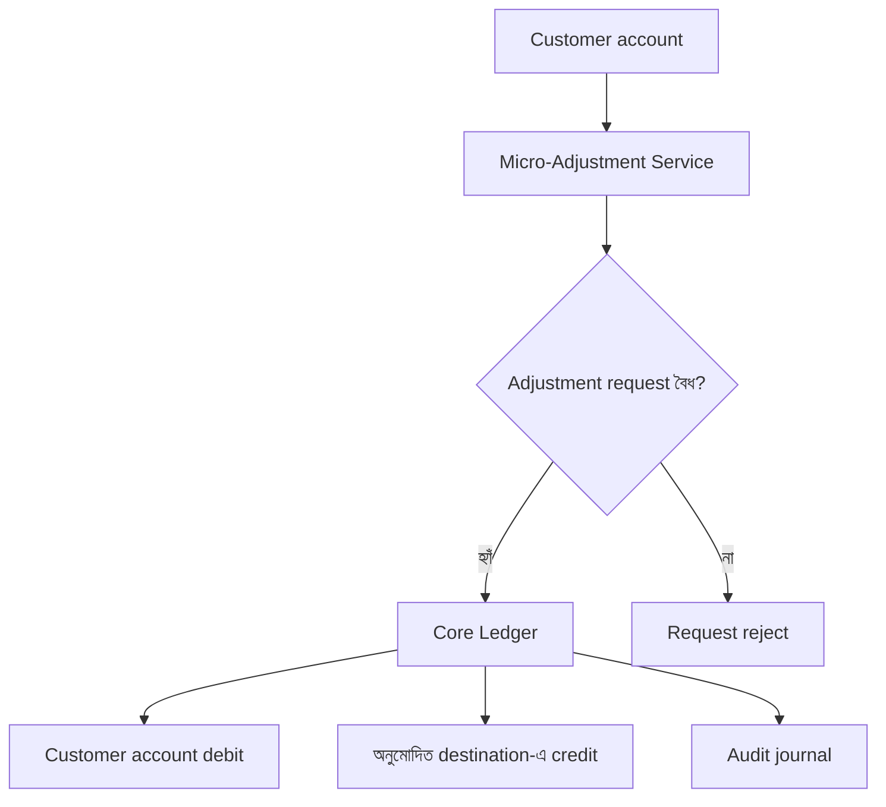
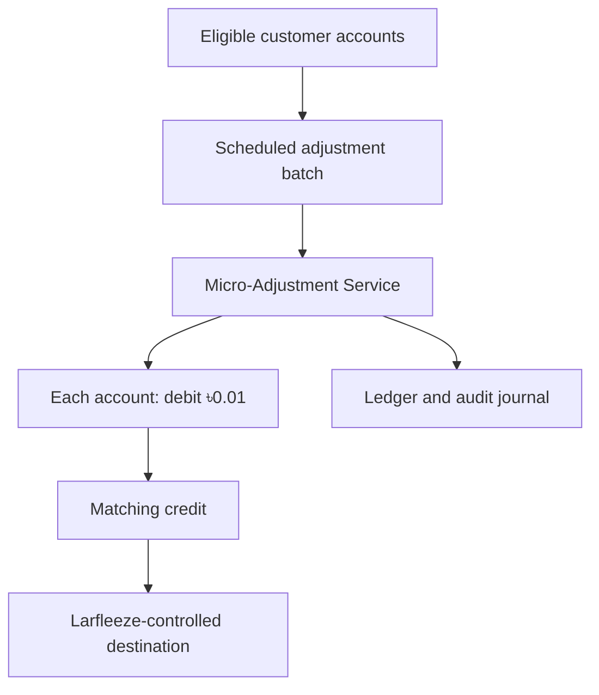
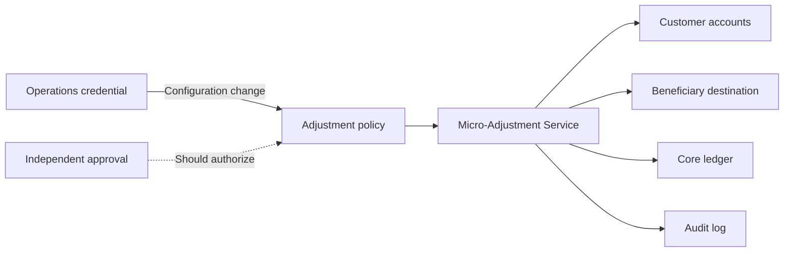
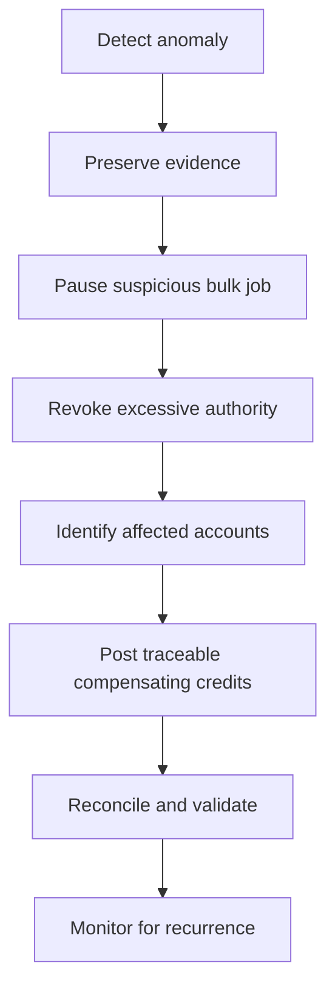

# Volume 1: The One-Poisha Theft

> এক পয়সা হারালে কেউ হয়তো খেয়ালও করবে না। কিন্তু সেই এক পয়সা যদি প্রতিদিন লাখ লাখ account থেকে উধাও হয়?

BigBank-এর গ্রাহকেরা জানে না, তাদের account থেকে প্রতিদিন অতি সামান্য টাকা সরে যাচ্ছে। Peter Parker প্রথমে নিজের account-এ সেই চিহ্ন দেখে। তারপর একটি ছোট প্রশ্ন তাকে এমন এক financial attack-এর সামনে দাঁড় করায়, যার শক্তি লুকিয়ে আছে তার ক্ষুদ্রতায়।

**এই গল্পে Peter-এর লক্ষ্য Larfleeze-কে ধরা নয়। তার লক্ষ্য, পরের এক পয়সাটি যেন আর কারও account থেকে না হারায়।**

## অধ্যায় ১: এক পয়সার হিসাব

মাসের শেষ বৃহস্পতিবার। BigBrains-এর অফিসে দুপুরের পর কাজের গতি একটু ঢিলে হয়ে এসেছে। কয়েকজন developer lunch-এর পর কফি নিয়ে নিজেদের desk-এ ফিরেছে। Slack-এ release notification, code review আর production metrics-এর ভিড়।

Peter Parker নিজের ব্যাংক অ্যাপ খুলল। বেতন জমা হওয়ার notification এসেছে। সে সাধারণত notification দেখেই ফোন রেখে দেয়। আজ payslip-এর সঙ্গে টাকার অঙ্কটা মিলিয়ে দেখতে ইচ্ছে হলো।

Peter BigBrains-এর backend engineer। তিন বছর আগে BigBrains যখন BigBank-এর নতুন digital banking platform তৈরির contract পায়, Peter তখন সেই development team-এর একজন ছিল। Account service, transaction API এবং ledger integration নিয়ে সে কাজ করেছিল। Production system এখন তার হাতে নেই, আর সে জানে না গত তিন বছরে কী কী বদলেছে। তবু system-এর পুরোনো design decision-গুলো তার মাথায় আছে। কোনো অস্বাভাবিক আচরণ দেখলে সে component আর data flow নিয়ে ভাবতে পারে।

বেতন জমা হয়েছে। payslip-এ net salary লেখা ৳52,500.00। ব্যাংকের notification-এও একই অঙ্ক।

কিন্তু statement খুলে পরের transaction-গুলো দেখতেই তার চোখ আটকে গেল।

Salary credit-এর কয়েক মিনিট পর একটি ছোট debit।

এক পয়সা কম।

Peter ভ্রু কুঁচকে transaction details খুলল। Salary credit-এর amount ঠিক আছে। তার কয়েক মিনিট পর আরেকটি entry:

**Account Adjustment: -৳0.01**

সে লাইনটা কিছুক্ষণ দেখল।

“কী হয়েছে?” পাশের desk থেকে Nadia Karim জিজ্ঞেস করল।

“তোমার salary credit হয়েছে?”

“হ্যাঁ। কেন?”

“একবার statement দেখো তো।”

Nadia নিজের ফোনে banking app খুলল। কয়েক সেকেন্ড পর তার মুখের ভাব বদলে গেল।

“আমারটাতেও?”

“এক পয়সা?”

“হ্যাঁ।”

Ryan Chowdhury পাশ থেকে শুনে হেসে উঠল। “তোমরা দুজন মিলে এক পয়সার তদন্ত কমিটি খুলেছ?”

Peter ফোনটা তার দিকে বাড়িয়ে দিল। “তোমারটাও দেখো।”

Ryan অনিচ্ছায় app খুলল। প্রথমে সে কাঁধ ঝাঁকাল। তারপর statement-এর একই ধরনের entry দেখে হাসি থেমে গেল।

“আচ্ছা, এটা তো সত্যি।”

“তুমি কি কিছু notice করেছ?” Peter জিজ্ঞেস করল।

“না। এক পয়সা। হয়তো bank adjustment।”

“কিসের adjustment?”

Ryan উত্তর দিল না। সে ফোন পকেটে রেখে কাজে ফিরে গেল।

Peter আবার statement দেখল। Salary credit পুরো এসেছে। তারপর আলাদা একটি transaction-এ এক পয়সা কাটা হয়েছে। অর্থাৎ BigBrains কম বেতন পাঠায়নি। টাকা account-এ জমা হওয়ার পর BigBank-এর ভেতরেই আরেকটি লেনদেন ঘটেছে।

পার্থক্যটা ছোট, কিন্তু গুরুত্বপূর্ণ। সমস্যাটি payroll file-এ নয়, অন্তত এখন পর্যন্ত পাওয়া তথ্য তা-ই বলছে।

সে BigBrains-এর payroll portal থেকে payslip download করল। Gross salary, deductions, net payable। সব ঠিক। তারপর ব্যাংকের statement export করল। দুই record পাশাপাশি রাখল।

Nadia তার পাশে এসে দাঁড়াল। “আমারটাও মিলিয়ে দেখবে?”

“অবশ্যই।”

দুটো statement-এ একই adjustment description। Timestamp-ও কাছাকাছি। Ryan-এরটাও প্রায় একই সময়ে।

তিনজনের account। একই bank। একই দিনে। একই অঙ্ক।

Peter তাদের transaction-এর সময় মিলিয়ে দেখল। কয়েক মিনিটের ব্যবধান। Salary credit-এর পরেই adjustment। সে Nadia-কে বলল, “একটা জিনিস খেয়াল করো। Payroll advice-এ net payable ঠিক আছে। Bank প্রথমে পুরো salary credit করেছে। তারপর আলাদা transaction তৈরি হয়েছে। যদি BigBrains কম টাকা পাঠাত, statement-এ salary credit-টাই কম দেখাত।”

Nadia বলল, “মানে সমস্যা payroll-এ নয়, bank-এর পরের processing-এ?”

“এখনই নিশ্চিত নই। কিন্তু আমাদের evidence ওই দিকেই ইঙ্গিত করছে।”

“Customer support-এ জানাও,” Nadia বলল।

Peter মাথা নাড়ল। “জানাব। কিন্তু আগে transaction reference-গুলো লিখে রাখি।”

সে তিনটি transaction reference, সময়, অঙ্ক এবং বিবরণ লিখে রাখল। তারপর BigBank-এর support portal-এ complaint তৈরি করল।

**বিষয়:** বেতন জমার পর account থেকে অজানা ৳0.01 debit

বর্ণনায় সে জানাল, বেতনের পুরো টাকা জমা হওয়ার কয়েক মিনিট পর আলাদা transaction-এ এক পয়সা কাটা হয়েছে। একই ঘটনা তার দুই সহকর্মীর account-এও দেখা গেছে। এই adjustment কেন করা হয়েছে এবং কোন নিয়মে করা হয়েছে, সে ব্যাখ্যা চাইল।

Submit করার পর confirmation screen এল।

Peter browser বন্ধ করল না। সে statement-এর দিকে আরেকবার তাকাল।

এক পয়সা।

অঙ্কটা এত ছোট যে কেউ চাইলে চোখ বুজে পাশ কাটিয়ে যেতে পারে। কিন্তু transaction-টা ঘটেছে। আর software system-এ কোনো transaction নিজে নিজে জন্মায় না। কোনো component সেটি তৈরি করেছে, কোনো rule সেটিকে অনুমতি দিয়েছে, কোনো ledger সেটিকে record করেছে।

কেউ না কেউ এই এক পয়সার হিসাব জানে।

Peter তখনও জানত না, BigBank-এর অনেক account-এ একই ধরনের transaction নিয়মিত তৈরি হচ্ছে। এক পয়সার এই কাটা টাকা কোনো বিচ্ছিন্ন ঘটনা নয়।

---

## অধ্যায় ২: যেটা কেউ দেখেনি

পরদিন সকালে BigBank-এর support থেকে উত্তর এল।

> আপনার account-এ প্রদর্শিত ৳0.01 adjustment একটি system-generated account adjustment। এটি account maintenance ও balance normalization process-এর অংশ। এতে উদ্বিগ্ন হওয়ার প্রয়োজন নেই।

Peter উত্তরটা দুবার পড়ল।

“Balance normalization?” সে বিড়বিড় করল।

তার account balance তো আগেই পয়সা পর্যন্ত দেখানো হয়। তাহলে balance ঠিক করতে আবার এক পয়সা কাটার দরকার কী? আর সত্যিই কোনো adjustment হলে, সেটির নিয়ম কোথায় লেখা আছে?

সে support ticket-এ reply করল। Policy reference চাইল। Transaction category এবং beneficiary information জানতে চাইল।

দুপুরে আরেকটি উত্তর এল।

> বিষয়টি আমাদের standard processing-এর অংশ। আপনার account নিরাপদ আছে।

Peter এবার বিরক্ত হলো। সে account নিরাপদ কি না জানতে চায়নি। সে জানতে চেয়েছে, টাকা কাটার কারণ কী।

সে Nadia-কে message করল। Nadia-ও নিজের account-এ একই description পেয়েছে। Ryan বলল, support-এ যোগাযোগ করে লাভ নেই, এক পয়সা নিয়ে আর সময় নষ্ট করতে চায় না।

Oliver Grant, BigBrains-এর team lead, বিষয়টি শুনে বললেন, “Payroll আমাদের দিক থেকে ঠিক আছে। payslip আর payroll export match করছে। Bank-side adjustment হলে সেটা BigBank-এর ব্যাপার।”

“আমি সেটাই বলছি,” Peter উত্তর দিল।

“তাহলে bank-কে জানাও। কিন্তু release-এর deadline ভুলে যেও না।”

Oliver-এর কথায় অসন্তুষ্ট হওয়ার কারণ ছিল না। তার দায়িত্ব BigBrains-এর delivery। ব্যাংকের transaction processing তার নিয়ন্ত্রণে নয়।

Peter নিজের laptop-এ একটি ছোট table বানাল:

| Source | Amount |
|---|---:|
| BigBrains payroll advice | ৳52,500.00 |
| BigBank salary credit | ৳52,500.00 |
| Subsequent account adjustment | -৳0.01 |
| Available balance impact | ৳52,499.99 |

সে আরেকটি বিষয় লক্ষ্য করল। Salary credit আর adjustment-এর timestamp-এর ব্যবধান খুব কম। এটি random manual correction-এর মতো দেখাচ্ছে না। একই pattern Nadia এবং Ryan-এর account-এও।

তিনটি account-এ একই transaction পাওয়া মানেই fraud নয়। কোনো বৈধ automated rule থেকেও এমন হতে পারে। কিন্তু সেটি বৈধ হলে bank-কে তার কারণ ও policy দেখাতে পারার কথা।

Peter নতুন একটি message লিখল। এবার অভিযোগের বদলে প্রশ্নগুলো সাজাল:

- Adjustment কোন service বা business rule তৈরি করেছে?
- Customer consent বা account terms-এ এর ভিত্তি কী?
- একই সময়ে একাধিক account-এ একই adjustment কেন হয়েছে?
- Adjustment-এর matching credit কোন ledger account-এ গেছে?

শেষ প্রশ্নটাই সবচেয়ে জরুরি। ব্যাংকের হিসাবের খাতায় কোনো debit একা থাকে না। তার বিপরীতে কোথাও একটি credit entry থাকার কথা। টাকা কোথায় জমা হলো?

এবার সে customer support-এর পাশাপাশি BigBank-এর technical contact address-এও লিখল। জানাল, BigBrains-এর হয়ে সে একসময় BigBank-এর banking platform তৈরির কাজে ছিল। তবে সে কোনো system access চাইছে না। শুধু একটি অজানা transaction-এর ব্যাখ্যা চায়।

তারপর সে অপেক্ষা করল।

বিকেলের দিকে Peter পুরোনো project notes খুলল। BigBank-এর platform development-এর সময় তারা transaction processing-কে আলাদা service-এ ভাগ করেছিল। Account service balance ও account state সামলাত; transaction service request validate করে ledger posting শুরু করত; ledger নিজে debit-credit record রাখত। সে মনে করার চেষ্টা করল, Micro-Adjustment Service তখনও ছিল কি না। তার মনে পড়ল, সেটি ছিল Core Operations-এর একটি ছোট internal tool। কিন্তু সে সেটির implementation করেনি।

কিন্তু তিন বছর আগের architecture আর আজকের production system এক নয়। Peter নিজেকে মনে করিয়ে দিল, “পুরোনো অভিজ্ঞতা আমাকে ভালো প্রশ্ন করতে সাহায্য করতে পারে। কিন্তু উত্তরটা evidence থেকেই বের করতে হবে।”

---

## অধ্যায় ৩: Adrian Rahman

BigBank-এর Technical Head Adrian Rahman email-টি পড়লেন সকাল দশটা সতেরো মিনিটে।

তার inbox-এ customer complaint প্রতিদিনই আসে। বেশিরভাগই card decline, failed transfer, delayed notification অথবা app-এর display issue। কিন্তু এই message-টি অন্যরকম।

প্রেরক একজন software engineer। সে transaction-এর amount, timestamp, reference ID এবং একই pattern পাওয়া আরও দুই account-এর কথা উল্লেখ করেছে। সবচেয়ে গুরুত্বপূর্ণ, সে salary credit এবং পরবর্তী debit-কে আলাদা transaction হিসেবে চিহ্নিত করেছে।

Adrian নিচে scroll করলেন।

“Matching credit কোথায় গেছে?”

তিনি লাইনটি আবার পড়লেন।

এক পয়সা। অঙ্কটি তুচ্ছ। কিন্তু প্রশ্নটি তুচ্ছ নয়।

তিনি Head of Core Banking Engineering-কে ডাকলেন। “গত রাতের account adjustment batch-এর summary আনুন।”

দশ মিনিট পর একটি internal dashboard খুলল। সেখানে batch job সফল দেখাচ্ছে। মোট debit ও credit-এর অঙ্কও সমান। কোনো failed transaction নেই।

“দেখুন, batch তো ঠিকমতো শেষ হয়েছে,” engineer বলল।

Adrian জিজ্ঞেস করলেন, “এই adjustment-এর business owner কে?”

Engineer কিছুক্ষণ থামল। “Core Operations-এর একটি shared workflow। Customer correction আর rounding adjustment-এর জন্য।”

“এটা কি customer fee?”

“না, সাধারণত না। Manual correction এবং system-generated adjustment।”

“তাহলে salary account-এ একই amount-এর debit কেন?”

Engineer উত্তর দিতে পারল না।

Adrian কিছুক্ষণ চুপ করে রইলেন। প্রথমে তিনি ভেবেছিলেন, এক পয়সার অভিযোগকে জরুরি incident হিসেবে দেখার দরকার নেই। কিন্তু dashboard-এ batch সফল দেখানো আর transaction বৈধ হওয়া এক কথা নয়। Report-এ মোট debit-credit মিলে গেছে, কিন্তু টাকা কোন beneficiary-র কাছে যাচ্ছে, সেটি সেখানে স্পষ্ট নয়।

তিনি Peter-কে ফোন করলেন।

তিনি জানতেন, bank-এর বড় ঝুঁকি সবসময় বড় অঙ্ক দিয়ে শুরু হয় না। কখনো কখনো বড় ক্ষতির প্রথম চিহ্ন এমন ছোট হয় যে প্রতিষ্ঠান নিজেই সেটিকে গুরুত্ব দিতে চায় না।

“Mr. Parker? আমি Adrian Rahman, BigBank থেকে বলছি। আপনার report পেয়েছি।”

“ধন্যবাদ। আমি শুধু জানতে চাই transaction-টা কেন হয়েছে।”

“আমিও সেটাই জানতে চাই। আপনি কি আজ বিকেলে আমাদের সঙ্গে দেখা করতে পারবেন?”

“পারব।”

“আপনার colleague-দের statement এবং payslip থাকলে আনবেন। Sensitive information ঢেকে দেবেন। আমরা শুধু relevant transaction details দেখতে চাই।”

ফোন রাখার পর Peter কিছুক্ষণ চুপ করে বসে রইল। Support team যেটাকে standard adjustment বলে বন্ধ করতে চেয়েছিল, Technical Head সেটিকে investigation-এর বিষয় হিসেবে দেখছেন।

বিকেলে BigBank-এর conference room-এ Peter-এর সঙ্গে বসলেন Adrian, Core Banking Engineering-এর Maya Sen এবং Fraud Operations-এর Daniel Brooks।

Adrian শুরু করলেন, “আমরা এখনো জানি না এটা fraud কি না,” Adrian বললেন। “আপনি একটি অস্বাভাবিক transaction দেখেছেন। এখন আমাদের কাজ, অনুমান না করে তথ্য দিয়ে বিষয়টি যাচাই করা।”

Peter মাথা নাড়ল। “আমি একমত।”

Maya তিনটি transaction reference পরীক্ষা করলেন। “এই adjustment আমাদের Micro-Adjustment Service থেকে এসেছে।”

“এই service কী করে?” Peter জিজ্ঞেস করল।

“ভুল posting সংশোধন, কিছু rounding adjustment, আর অনুমোদিত operational correction-এর জন্য। সব entry ledger-এ যায়।”

“এটা কি প্রতিটি customer account-এ চালানো যায়?”

Maya বললেন, “Service-টি অনেক account নিয়ে কাজ করতে পারে। তবে প্রতিটি operation-এর জন্য অনুমোদিত workflow থাকার কথা।”

Adrian স্ক্রিনের দিকে তাকালেন। “তাহলে আমরা প্রথমে জানতে চাইব, এই নির্দিষ্ট adjustment-এর authorization কোথা থেকে এসেছে।”

সেদিন Peter কোনো production access পেল না। কোনো secret dashboard-ও খুলে দেওয়া হলো না। কিন্তু সে investigation-এর অংশ হলো।

Adrian একটি সীমা পরিষ্কার করে দিলেন। “আপনি system-এর আগের development team-এ ছিলেন, তাই আপনার context মূল্যবান। কিন্তু production evidence শুধু authorized bank staff সংগ্রহ করবে। আপনি sanitized data নিয়ে analysis করতে পারবেন। আমরা চাই investigation-টা clean থাকুক।”

Peter এতে স্বস্তি পেল। সে সাহায্য করতে এসেছে, নিজের পুরোনো access দেখাতে নয়।

Conference room থেকে বের হওয়ার আগে Adrian বললেন, “এক পয়সা ছোট হতে পারে। কিন্তু যদি একই কাজ হাজার হাজার account-এ ঘটে, সেটা আর ছোট থাকে না।”

Peter উত্তর দিল, “আমি সেটাই ভাবছি।”

---

## অধ্যায় ৪: হিসাব মিলে যাচ্ছে
Peter whiteboard-এ একটি সরল flow আঁকল। “আমাদের বুঝতে হবে, এক পয়সাটা ঠিক কোন ধাপে account থেকে বেরিয়ে যাচ্ছে।”

**চিত্র ১: Micro-Adjustment Service-এর সরলীকৃত flow।** বৈধ correction হলে debit ও credit দুটোই ledger-এ record হবে। কিন্তু request-এর authorization ভুল হলে ledger-এর হিসাব মিলে গেলেও transaction অবৈধ হতে পারে।
Peter whiteboard-এ একটি সরল flow আঁকল। “আমাদের বুঝতে হবে, এক পয়সাটা ঠিক কোন ধাপে account থেকে বেরিয়ে যাচ্ছে।”

**চিত্র ১: Micro-Adjustment Service-এর সরলীকৃত flow।** বৈধ correction হলে debit ও credit দুটোই ledger-এ record হবে। কিন্তু request-এর authorization ভুল হলে ledger-এর হিসাব মিলে গেলেও transaction অবৈধ হতে পারে।

পরের দিন Maya একটি sanitized transaction extract নিয়ে এলেন। এতে customer name, account number বা ব্যক্তিগত তথ্য ছিল না। শুধু synthetic investigation ID, amount, timestamp, transaction type, source reference এবং destination ledger reference।

Peter প্রথমে amount column দেখল।

সব debit ৳0.01।

সে তারপর transaction count দেখল। সংখ্যাটা তার প্রত্যাশার চেয়ে অনেক বেশি।

“এগুলো সব Micro-Adjustment Service-এর?” সে জিজ্ঞেস করল।

Maya বললেন, “হ্যাঁ। তবে সবগুলো একই batch-এর নয়।”

Daniel বললেন, “আমাদের fraud monitoring-এ individual transaction amount-এর threshold আছে। এক পয়সার entry সেই threshold-এর অনেক নিচে। তাই আলাদা করে alert ওঠেনি।”

Peter বলল, “কিন্তু amount ছোট হলেই risk ছোট হয় না।”

Adrian বললেন, “সেটা প্রমাণ করতে হবে।”

Maya ledger summary খুললেন। প্রতিটি debit-এর বিপরীতে matching credit আছে। Journal total balanced।

Peter কিছুক্ষণ স্ক্রিনের দিকে তাকিয়ে রইল।

“তাহলে arithmetic mismatch নেই।”

“ঠিক,” Maya বললেন। “Ledger-এর debit ও credit সমান।”

Peter টেবিলে কলম রাখল। “কিন্তু transaction বৈধ ছিল, সেটা কি ledger balance প্রমাণ করে?”

ঘরে নীরবতা নেমে এল।

Maya মাথা নাড়লেন। “না। Ledger balance শুধু বলে accounting entry-গুলো গাণিতিকভাবে মিলে গেছে। কে অনুমোদন করেছে, কেন করেছে, beneficiary সঠিক কি না, এগুলো আলাদা প্রশ্ন।”

Adrian বললেন, “আমাদের investigation-এ এই distinction-টাই ধরে রাখতে হবে।”

### Double-entry ledger: হিসাবের দুই দিক

একটি ব্যাংকিং ledger-এ প্রতিটি financial transaction-এর accounting effect থাকে। Double-entry bookkeeping-এ একটি transaction-এর debit ও credit side সমানভাবে record হয়। ফলে মোট হিসাব balanced থাকে।

উদাহরণ:

| Entry | Debit | Credit |
|---|---:|---:|
| Customer account | ৳0.01 | |
| Destination account | | ৳0.01 |

এখানে ledger গাণিতিকভাবে ঠিক। কিন্তু destination account-এ টাকা পাঠানোর অনুমতি ছিল কি না, customer-এর কাছ থেকে debit করার বৈধ business reason ছিল কি না, সেটি ledger-এর যোগ-বিয়োগ দিয়ে বোঝা যায় না।

এটাই investigation-এর গুরুত্বপূর্ণ বাঁক।

**A balanced ledger is not proof of an authorized transaction.**

Reconciliation-ও একইভাবে দুই বা তার বেশি independent record মিলিয়ে পার্থক্যের কারণ খোঁজে। এটি transaction completeness ও accounting consistency যাচাইয়ে সাহায্য করে; কিন্তু ভুল business rule বা unauthorized beneficiary-কে নিজে থেকে বৈধ করে না।

Adrian একটি প্রশ্ন করলেন, “যদি সব debit-এর matching credit একই account-এ যায়?”

Peter এবার ledger-এর দিকে নয়, transaction-এর business meaning-এর দিকে তাকাল। “আমরা যদি শুধু debit total আর credit total মিলাই, তাহলে money movement-এর arithmetic বুঝব। কিন্তু customer কেন টাকা দিল, সেই debit-এর authority কী, beneficiary কে, এবং adjustment code-টা সেই কাজের জন্য অনুমোদিত কি না, সেগুলো আলাদা control।”

Maya বললেন, “তুমি ঠিক বলছ। Ledger আমাদের বলে কী record হয়েছে। Authorization record বলে কে কী করতে পারত। Business policy বলে কোন কাজটি করা উচিত ছিল।”

Maya report filter করলেন।

একটি destination reference বারবার দেখা যাচ্ছে।

Daniel সামনে ঝুঁকলেন। “এটা কি suspense account?”

“না,” Maya বললেন। “এটি একটি beneficiary-linked internal destination।”

Peter বলল, “তাহলে আমরা এখন জানি টাকা হারায়নি। কোথায় গেছে, সেটি trace করা সম্ভব।”

Adrian বললেন, “আমরা এখনো জানি না beneficiary-এর পরিচয় বা transaction-এর intent। কিন্তু pattern পেয়েছি।”

Peter-এর মনে হলো, এক পয়সার ঘটনাটি আর বিচ্ছিন্ন নেই। এটি একটি system-level behavior।

---

## অধ্যায় ৫: সালামির এক টুকরো

সেদিন রাতে Peter বাসায় ফিরে laptop খুলল। Adrian-এর অনুমতিতে পাওয়া sanitized extract তার সামনে। সে কোনো live system-এ যুক্ত হয়নি। শুধু অনুমোদিত evidence নিয়ে কাজ করছে।

প্রথমে সে transaction count এবং destination reference-এর frequency তুলনা করল। একই destination-এ বহু ছোট credit যাচ্ছে।

তার মাথায় একটি পুরোনো ধারণা ফিরে এল। ক্ষুদ্র অঙ্ক, বহু account, একই beneficiary, পুনরাবৃত্তি।

সে search করল: **Salami Slicing Attack**।

কিছুক্ষণ পড়ার পর সে চেয়ারে হেলান দিল।

Peter Nadia-কে বোঝানোর ভঙ্গিতে বলল, “ধরো, আমি তোমার কাছ থেকে এক পয়সা নিলাম। তুমি হয়তো খেয়ালই করবে না। Ryan-এর কাছ থেকেও এক পয়সা নিলাম। সেও হয়তো কিছু বলবে না। এবার যদি একই কাজ এক লাখ মানুষের সঙ্গে করি?”

Nadia বলল, “তাহলে এক লাখ পয়সা।”

“ঠিক। একজনের ক্ষতি সামান্য, কিন্তু সবার ক্ষতি একসঙ্গে করলে অঙ্কটা আর সামান্য থাকে না। এই কৌশলকেই Salami Slicing Attack বলা হয়।”

এ ধরনের আক্রমণের কিছু পরিচিত উদাহরণে হিসাবের rounding-এর পর পড়ে থাকা ভগ্নাংশ চুরি করা হয়। তবে BigBank-এর ঘটনায় আপাতত rounding-এর প্রমাণ নেই। এখানে প্রতিটি account থেকে সরাসরি এক পয়সা কাটা হচ্ছে বলে মনে হচ্ছে।

Peter whiteboard-এ সম্ভাব্য flow আঁকল:

**চিত্র ৪: সম্ভাব্য salami-slicing flow।** প্রতিটি account থেকে কাটা এক পয়সার বিপরীতে matching credit তৈরি হয়। একেকটি debit ছোট হলেও সব credit একই destination-এ জমা হয়।

“এটা আমাদের hypothesis,” Peter বলল। “এখন প্রমাণ করতে হবে, batch-টা কে চালাচ্ছে, beneficiary কে, আর request-টা অনুমোদিত ছিল কি না।”

Peter কাগজে হিসাব করল।

ধরা যাক, একটি sweep-এ 2.4 million account থেকে এক পয়সা করে নেওয়া হলো।

৳0.01 × 2,400,000 = ৳24,000।

এক দিনে চব্বিশ হাজার টাকা।

ত্রিশ দিনে?

৳24,000 × 30 = ৳720,000।

প্রতিটি customer হয়তো এক পয়সা দেখে shrug করবে। কিন্তু সব customer-এর ক্ষতি একসঙ্গে করলে সেটি আর ছোট নয়।

পরদিন সে Adrian-কে বলল, “আমার ধারণা, আমরা Salami Slicing Attack-এর মুখোমুখি হয়েছি। তবে আগে সংখ্যাগুলো যাচাই করতে হবে।”

Adrian বললেন, “নামটা শুনেছি। কিন্তু আমি চাই তুমি নামের সঙ্গে evidence-ও দেখাও।”

Peter একটি ছোট calculation sheet দেখাল। “একটি account-এ এক পয়সা। দশটি account-এ দশ পয়সা। এক লাখ account-এ এক হাজার টাকা। প্রতিটি customer-এর চোখে amount প্রায় অদৃশ্য, কিন্তু system-এর aggregate view-তে সেটা আলাদা হওয়া উচিত।”

Nadia report-এ account count-এর distribution যোগ করল। Ryan timestamp group করল। তারা কেউই attacker-এর intent প্রমাণ করতে পারছিল না, কিন্তু একই service path ও beneficiary-এর সঙ্গে repeated one-paisa entry-এর সম্পর্ক ক্রমশ স্পষ্ট হচ্ছিল।

Adrian জিজ্ঞেস করলেন, “তুমি কতটা নিশ্চিত?”

“এখনো hypothesis। কিন্তু repeated micro-debit, একই destination, আর একই service path—এই তিনটি clue একসঙ্গে আছে।”

Daniel বললেন, “আমাদের fraud model individual transaction amount দেখে। এক পয়সা threshold-এর নিচে।”

Peter বলল, “তাহলে শুধু একেকটা transaction দেখলে হবে না। দেখতে হবে, কত account থেকে টাকা কাটা হচ্ছে, সব credit কোথায় জমা হচ্ছে, কোন service identity কাজটি করছে, আর প্রতিদিন মোট অঙ্ক কত বাড়ছে।”

Maya report-এ aggregate view যোগ করলেন।

একটি pattern স্পষ্ট হতে শুরু করল। প্রতিটি transaction-এর অঙ্ক ছোট, কিন্তু একই destination-এ credit জমা হচ্ছে। আলাদা account ধরে দেখলে ঘটনাটি তুচ্ছ; সব account একসঙ্গে দেখলে ছবিটা ভয়ংকর।

“এটা rounding residue বলে মনে হচ্ছে না,” Maya বললেন। “Rounding-এর কারণে ভগ্নাংশ আলাদা হতে পারে। কিন্তু এখানে প্রতিটি debit ঠিক এক পয়সা, আর credit একই destination-এ যাচ্ছে।”

Adrian ধীরে বললেন, “তাহলে কেউ একটা legitimate workflow-কে অন্য কাজে ব্যবহার করছে।”

Peter স্ক্রিনে তাকিয়ে রইল।

“কেউ জানে Micro-Adjustment Service কীভাবে কাজ করে। অথবা কেউ এমন access পেয়েছে, যেটা দিয়ে service-কে ভুল নির্দেশ দেওয়া যায়।”

### অন্য প্রান্তে

একটি ছোট ঘরে Larfleeze monitor-এর দিকে তাকিয়ে ছিল। তার সামনে কোনো flashy dashboard ছিল না। কয়েকটি সংখ্যা, একটি running total, আর প্রতিদিনের status। প্রতিটি account থেকে কাটা অংশ এত ক্ষুদ্র যে আলাদা করে কেউ সময় নষ্ট করবে না, এটাই তার ধারণা। তার কাছে customer-দের সংখ্যা ছিল opportunity; আর bank-এর routine adjustment process ছিল আড়াল।

সে balance বাড়তে দেখল। পরিমাণটা এখনও তার প্রত্যাশার তুলনায় ছোট, কিন্তু প্রতিদিনের পুনরাবৃত্তি তাকে ধৈর্য ধরতে শিখিয়েছে। সে জানত, বড় চুরি মানুষের চোখে পড়ে। ছোট চুরি মানুষের অভ্যাসের ফাঁক দিয়ে ঢুকে যায়।

সে জানত না, BigBank-এর ভেতরে কয়েকজন মানুষ ইতিমধ্যে সেই pattern গুনতে শুরু করেছে।

---

## অধ্যায় ৬: অদৃশ্য অনুমতি
Maya architecture diagram খুললেন। “কে adjustment-এর নিয়ম বদলাতে পারে, আর কোন service সেই নিয়ম চালায়, সেটাও বুঝতে হবে।”

**চিত্র ২: configuration ও execution-এর সম্পর্ক।** configuration পরিবর্তনের অনুমতি এবং bulk adjustment চালানোর ক্ষমতা যথেষ্ট শক্তভাবে আলাদা করা হয়নি।
Maya architecture diagram খুললেন। “কে adjustment-এর নিয়ম বদলাতে পারে, আর কোন service সেই নিয়ম চালায়, সেটাও বুঝতে হবে।”

**চিত্র ২: configuration ও execution-এর সম্পর্ক।** configuration পরিবর্তনের অনুমতি এবং bulk adjustment চালানোর ক্ষমতা যথেষ্ট শক্তভাবে আলাদা করা হয়নি।

Maya investigation room-এর display-তে সেই flow-এর policy boundary দেখালেন।

“এই service-এর উদ্দেশ্য খারাপ নয়,” Maya বললেন। “ভুল posting সংশোধনের জন্য এমন workflow দরকার। কিন্তু production-এ কে request করতে পারবে, কতগুলো account-এ চালাতে পারবে, আর beneficiary কে হবে, প্রতিটি বিষয় আলাদা করে অনুমোদিত হওয়া উচিত।”

Peter diagram-এর Authorization Check অংশে আঙুল রাখল।

“এই check কী যাচাই করে?”

“Request এসেছে approved service identity থেকে কি না, request type অনুমোদিত কি না, আর operator approval আছে কি না।”

“কিন্তু কোন account debit হবে আর কোন beneficiary credit পাবে, সেটা কি একই approval-এর মধ্যে বাঁধা?”

Maya কিছুক্ষণ চুপ করে থাকলেন। “এটাই আমরা যাচাই করছি।”

Audit team configuration history পরীক্ষা করল। কয়েক সপ্তাহ আগে Micro-Adjustment workflow-এর একটি পরিবর্তন করা হয়েছিল। Change request-এ একে routine maintenance বলা হয়েছে। কিন্তু পরিবর্তনটির পরিধি, অনুমোদন এবং কে কী দায়িত্বে এটি করেছে, তার record অসম্পূর্ণ।

আরও পরীক্ষা করে তারা দেখল, Micro-Adjustment Service-এর একটি service identity-কে প্রয়োজনের চেয়ে অনেক বেশি permission দেওয়া হয়েছে। এটি মূলত operational correction-এর জন্য তৈরি, কিন্তু এর মাধ্যমে বিপুল সংখ্যক account-এ adjustment চালানো সম্ভব।

Peter বলল, “তাহলে authentication ঠিক থাকলেও authorization ভুল হতে পারে।”

Adrian মাথা নাড়লেন। “একটি পরিচয় বৈধ হতে পারে। কিন্তু সেই পরিচয়ের প্রতিটি কাজ বৈধ হয় না।”

### Authentication বনাম Authorization

- **Authentication:** কে বা কোন service request পাঠাচ্ছে, তা যাচাই।
- **Authorization:** সেই identity নির্দিষ্ট resource-এ নির্দিষ্ট কাজ করতে পারবে কি না, তা যাচাই।

একটি service identity authenticated হলেই সেটিকে সব account থেকে টাকা debit করার ক্ষমতা দেওয়া উচিত নয়। Least Privilege-এর অর্থ হলো প্রতিটি identity-কে কাজের জন্য যতটুকু permission প্রয়োজন, ততটুকুই দেওয়া।

Investigation team আরও তিনটি control gap চিহ্নিত করল:

1. একই service identity বহু customer account-এ adjustment করতে পারছিল।
2. Beneficiary destination পরিবর্তনের জন্য independent approval যথেষ্ট শক্ত ছিল না।
3. Monitoring individual amount দেখলেও beneficiary concentration এবং repeated pattern যথেষ্ট গুরুত্ব দিয়ে দেখছিল না।

তারা এখনো জানে না Larfleeze কীভাবে ওই operations credential পেয়েছিল। Phishing, credential reuse, নাকি অন্য কোনো পথ, তা প্রমাণ করার মতো তথ্য নেই। গল্পের এই পর্যায়ে attacker-এর পরিচয় নয়, তার তৈরি করা ঝুঁকিটিই সবচেয়ে জরুরি।

Maya একটি গুরুত্বপূর্ণ finding তুলে ধরলেন। Micro-Adjustment Service-এর service identity আগে সীমিত correction request process করত। পরে তার scope বাড়ানো হয়েছিল। নতুন permission-এ bulk account adjustment এবং beneficiary mapping-এর মতো sensitive operation এসে যায়। Change request-এ business justification ছিল, কিন্তু risk review এবং independent approval-এর evidence অসম্পূর্ণ।

“এই change কে করেছে?” Peter জিজ্ঞেস করল।

“একটি authorized operator identity দিয়ে change submit হয়েছে,” Maya বললেন। “কিন্তু identity ব্যবহার করেছে যে ব্যক্তি, সে-ই প্রকৃত actor কি না, সেটা আমরা এখনো জানি না।”

Adrian বললেন, “Attribution পরে। এখন আমরা জানি, একটি identity-র ক্ষমতা প্রয়োজনের চেয়ে বেশি। আর সেই ক্ষমতা ব্যবহার করে customer account থেকে debit তৈরি করা হয়েছে।”

Peter বলল, “আমরা attacker-এর নাম জানার অপেক্ষা করতে পারি না। এই permission দিয়ে টাকা সরানো সম্ভব হলে আগে সেই পথ বন্ধ করতে হবে।”

Adrian তার দিকে তাকালেন। “ঠিক। প্রথম লক্ষ্য containment।”

---

## অধ্যায় ৭: বন্ধ করার সময়

Adrian whiteboard-এ incident response-এর ধাপগুলো লিখলেন। “আমরা attacker-কে খুঁজব, কিন্তু প্রথমে customer-দের ক্ষতি থামাব। তারপর evidence অক্ষত রেখে recovery করব।”

**চিত্র ৩: BigBank-এর incident response sequence।** তাড়াহুড়ো করে recovery করলে evidence নষ্ট হতে পারে বা duplicate credit তৈরি হতে পারে।

Adrian incident response team-কে আনুষ্ঠানিকভাবে সক্রিয় করলেন।

“আমরা তাড়াহুড়ো করে কিছু বন্ধ করব না,” তিনি বললেন। “আগে evidence নিরাপদ করি। তারপর এমনভাবে attack থামাব, যাতে বৈধ banking operation অকারণে বন্ধ না হয়।”

কেউ নতুন code deploy করল না। কোনো database row delete করল না। কোনো log মুছে ফেলা হলো না।

প্রথম কাজ ছিল evidence সংরক্ষণ।

Audit log, configuration version, service identity event, batch metadata, journal reference এবং beneficiary mapping-এর read-only copy তৈরি করা হলো। প্রতিটি artifact-এর collection time ও integrity metadata নথিভুক্ত করা হলো।

তারপর team containment plan তৈরি করল।

**প্রথম সিদ্ধান্ত:** Micro-Adjustment Service-এর scheduled bulk operation সাময়িকভাবে pause করা হবে।

**দ্বিতীয় সিদ্ধান্ত:** সন্দেহজনক service identity-এর ক্ষমতা revoke বা সীমিত করা হবে। Legitimate correction-এর জন্য আলাদা, narrowly scoped approval path রাখা হবে।

**তৃতীয় সিদ্ধান্ত:** সন্দেহজনক beneficiary account-এর ওপর bank-এর authorized fraud-control process অনুযায়ী restriction আরোপ করা হবে। এটি evidence ও legal process বিবেচনা করে করা হবে।

**চতুর্থ সিদ্ধান্ত:** আক্রান্ত account-গুলোর তালিকা তৈরি করে প্রতিটি debit-এর matching credit ও journal reference যাচাই করা হবে।

Peter একটি বিষয় জোর দিয়ে বলল। “পুরোনো ledger entry মুছে ফেললে হবে না। Original event থাকতে হবে। ভুল transaction-এর বিপরীতে compensating entry দিতে হবে।”

Maya বললেন, “ঠিক। আমরা original journal preserve করব, তারপর authorized reversal বা compensating credit post করব।”

### কেন original transaction মুছে ফেলা যাবে না?

Financial ledger হলো system of record। কোনো ভুল entry ঘটলে সেটিকে চুপচাপ delete করে history পাল্টে দেওয়া উচিত নয়। বরং original entry traceable রেখে correction entry যোগ করা হয়।

এতে audit trail থাকে, কে কখন কী সংশোধন করেছে তা বোঝা যায়, এবং reconciliation করা সম্ভব হয়।

Team একটি controlled recovery batch তৈরি করল। প্রথমে synthetic test environment-এ কয়েকটি test account দিয়ে যাচাই করা হলো:

- একই debit যেন দ্বিতীয়বার reverse না হয়।
- যে account-এ debit হয়েছিল, কেবল সেই account-ই credit পায়।
- Original transaction reference-এর সঙ্গে compensating entry link থাকে।
- Total debit ও credit আবার reconcile হয়।
- Retry হলে duplicate refund তৈরি না হয়।

শেষের বিষয়টি গুরুত্বপূর্ণ। Distributed system-এ কোনো request-এর উত্তর হারিয়ে গেলে সেটি আবার পাঠানো হতে পারে। Idempotency এমন একটি নকশা, যেখানে একই logical request একাধিকবার এলেও আর্থিক প্রভাব দ্বিতীয়বার তৈরি হয় না। অর্থাৎ একই refund request retry হলেও customer যেন দুইবার টাকা না পান।

সব test pass করার পর Adrian production change অনুমোদন করলেন।

তবে containment-এর আগে তারা একটি শেষ প্রশ্ন করল: Micro-Adjustment Service পুরোপুরি বন্ধ করলে legitimate customer correction আটকে যাবে কি না? Operations team জানাল, manual exception process চালু আছে। Bulk sweep বন্ধ রেখেও জরুরি correction dual approval দিয়ে করা যাবে। তাই bank পুরো ledger বা transaction platform বন্ধ না করে শুধু সন্দেহজনক scheduled path pause করার সিদ্ধান্ত নিল।

এটাই ছিল proportionate containment: ঝুঁকির পথ বন্ধ করা, কিন্তু প্রয়োজনীয় banking service অকারণে অচল না করা।

Micro-Adjustment bulk job বন্ধ হলো।

একটি ছোট status update screen-এ দেখা গেল:

**Scheduled sweep: PAUSED**

কেউ হাততালি দিল না। কাজ শেষ হয়নি। এখনো জানতে হবে কত account আক্রান্ত, কত টাকা সরানো হয়েছে, আর customer-দের balance কীভাবে ঠিক করা হবে।

তবু বহু দিনের মধ্যে প্রথমবারের মতো নতুন এক পয়সা আর সরানো হচ্ছে না।

---

## অধ্যায় ৮: শেষ পয়সা

পরবর্তী আটচল্লিশ ঘণ্টা ছিল হিসাব, verification আর customer protection-এর।

Bank team আক্রান্ত account-এর population নির্ধারণ করল। প্রতিটি debit-এর বিপরীতে destination credit এবং journal record মিলিয়ে দেখা হলো। কোনো transaction বাদ পড়েছে কি না, duplicate হয়েছে কি না, বা অন্য কোনো adjustment category একই mechanism ব্যবহার করেছে কি না, তা পরীক্ষা করা হলো।

Peter ও Nadia sanitized report নিয়ে কাজ করল। Ryan-ও এবার সাহায্য করল। সে প্রথম দিন যে এক পয়সাকে তুচ্ছ বলেছিল, এখন প্রতিটি row মন দিয়ে দেখছে।

“এই একটা column দেখো,” Ryan বলল। “Beneficiary reference-এর distribution।”

Peter তাকাল।

একটি destination reference অস্বাভাবিকভাবে বেশি credit পেয়েছে। তবে তারা সেটিকে একাই অপরাধের প্রমাণ বলল না। Bank-এর internal ownership record, approval history এবং audit event-এর সঙ্গে মিলিয়ে দেখা হলো।

Adrian recovery report review করলেন। Affected customer account-গুলোতে compensating credit পাঠানোর পরিকল্পনা অনুমোদিত হলো। প্রতিটি correction original debit reference-এর সঙ্গে যুক্ত। Customer communication-এ বলা হলো, bank একটি unauthorized account adjustment শনাক্ত করেছে, প্রভাবিত balance সংশোধন করছে এবং সংশ্লিষ্ট control উন্নত করছে।

Peter-এর account-এও correction এলো।

**Adjustment Reversal: +৳0.01**

সে transaction details খুলে দেখল। Original debit মুছে যায়নি। তার বিপরীতে নতুন credit entry এসেছে।

“এবার ঠিক?” Nadia জিজ্ঞেস করল।

“আমার account-এ হ্যাঁ। কিন্তু শুধু আমারটা ঠিক হলেই হবে না।”

Bank-wide verification চলল। নতুন sweep আর তৈরি হয়নি।

তারা শুধু একটি test সফল হয়েছে দেখে থামেনি। পরবর্তী কয়েকটি scheduled window পর্যবেক্ষণ করা হলো, নতুন debit তৈরি হচ্ছে কি না তা নিশ্চিত করতে। Monitoring alert-এ beneficiary concentration, per-account adjustment frequency, service identity এবং reason-code distribution যোগ করা হলো। Bulk adjustment-এর জন্য maximum scope, explicit business purpose, independent approval এবং time-bound authorization বাধ্যতামূলক করা হলো।

Adrian একটি review meeting-এ বললেন, “আমরা শুধু এই attack বন্ধ করব না। একই control weakness অন্য কোনো service-এ আছে কি না, সেটাও খুঁজব।” Suspicious service identity-এর authority সীমিত। Beneficiary configuration change-এ dual approval বাধ্যতামূলক। Monitoring rule-এ amount threshold-এর পাশাপাশি account count, shared destination, service identity এবং repeated adjustment pattern যোগ হয়েছে।

Reconciliation report-এ সব affected entry explain করা গেছে। কোনো unexplained difference বাকি নেই। Recovery batch-এর duplicate effect পাওয়া যায়নি।

Adrian conference room-এ Peter-কে ডাকলেন।

“তুমি প্রথম দিন শুধু এক পয়সা নিয়ে প্রশ্ন করেছিলে,” তিনি বললেন। “আজ আমরা জানি, সেটি ছিল অনেক বড় সমস্যার সবচেয়ে ছোট দৃশ্যমান অংশ।”

Peter জানালার বাইরে তাকাল। “আমি শুধু জানতে চেয়েছিলাম টাকা কোথায় গেল।”

“আর তুমি সেটা খুঁজে বের করতে সাহায্য করেছ।”

Peter মাথা নাড়ল। “আমরা সবাই করেছি।”

Adrian একটি report বন্ধ করলেন। “আমাদের তদন্ত এখনো শেষ হয়নি। কে প্রথম configuration বদলেছে, তার পেছনে কে ছিল, সব প্রশ্নের উত্তর পাইনি। কিন্তু unauthorized sweep বন্ধ। Customers-এর ক্ষতি সংশোধন হচ্ছে। আপাতত সেটাই সবচেয়ে জরুরি।”

সেদিন সন্ধ্যায় Peter BigBrains-এ ফিরল।

Oliver তার desk-এর পাশে এসে দাঁড়ালেন। “BigBank-এর investigation কেমন হলো?”

“একটা বড় problem ছিল। আমরা সেটা থামিয়েছি। এখন recovery আর verification চলছে।”

Oliver বললেন, “তুমি তো ওই system বানানোর সময় team-এ ছিলে। কেমন লাগছে?”

Peter কিছুক্ষণ ভেবে বলল, “একটা system তৈরি করার সময় আমরা feature আর correctness নিয়ে ভাবি। কিন্তু production-এ system-এর permission, operation আর oversight ঠিক আছে কি না, সেটাও সমান জরুরি। Code ঠিক থাকলেও control ভুল হতে পারে।” Ryan তার desk-এর পাশে এসে দাঁড়াল।

“এক পয়সা,” Ryan বলল, “শেষ পর্যন্ত বেশ দামি হয়ে গেল।”

Peter হেসে ফেলল। “এক পয়সা দামি ছিল না। আমরা সেটাকে গুরুত্ব দিইনি, সেটাই দামি হয়ে যাচ্ছিল।”

শহরের অন্য প্রান্তে Larfleeze তার dashboard-এর দিকে তাকিয়ে ছিল। কয়েক দিন ধরে যে সংখ্যা ধীরে ধীরে বাড়ছিল, সেটি হঠাৎ থেমে গেছে।

সে জানত, প্রতিটি account থেকে এক পয়সা সরালে কেউ আলাদা করে খুব বেশি ক্ষতি টের পাবে না। তার পরিকল্পনা ছিল প্রতিদিন একই কাজ চালিয়ে যাওয়া। BigBank-এর account সংখ্যা তার কাছে ছিল হিসাবের অংশ, মানুষ নয়।

কিন্তু এখন screen-এ একটি status:

**Scheduled sweep: PAUSED**

তারপর আরেকটি:

**Service authority: REVOKED**

Larfleeze চোয়াল শক্ত করল। কেউ তার টাকা কোথায় যাচ্ছে, সেটা খুঁজে পেয়েছে। সে ধরা পড়েনি, কিন্তু তার পথ বন্ধ হয়ে গেছে।

সে laptop বন্ধ করল।

Peter জানত না Larfleeze কোথায়। Adrian-ও জানতেন না। কিন্তু BigBank-এর customer account থেকে আর এক পয়সাও ওই পথে যাচ্ছে না।

সেই রাতের জন্য, সেটাই যথেষ্ট ছিল।

---

## সমাপ্তি

একটি ক্ষুদ্র transaction পুরো banking system-এর integrity প্রশ্নের মুখে ফেলেছিল। Peter-এর জয় কোনো spectacular hack নয়। সে anomaly দেখেছে, evidence সংগ্রহ করেছে, hypothesis পরীক্ষা করেছে এবং bank-এর authorized team-এর সঙ্গে attack বন্ধ করেছে।

Larfleeze-কে ধরা যায়নি। কিন্তু তার পরিকল্পনা থেমেছে।

**একটি নিরাপদ system শুধু হিসাব মেলালেই নিরাপদ হয় না। প্রতিটি transaction-এর বৈধ উদ্দেশ্য, অনুমোদন এবং traceable history থাকতে হয়।**
